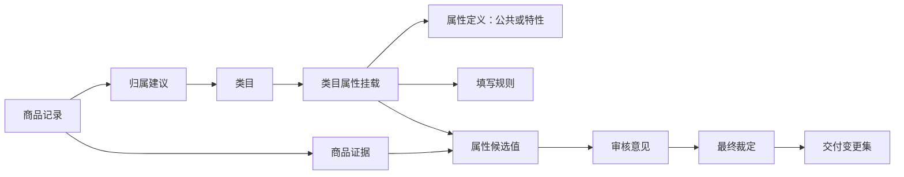

# 商品治理架构方案 v0.1

确认日期：2026-10-18。状态：用户已确认，作为第一版架构方案。本次交付范围为架构设计。

本文汇总四轮讨论和最终共识确认。业务原则、总体架构及首批切入点已经确定；字段名、接口签名和执行参数可在实现前细化。代码块展示约定形态，属性案例仍需按本文流程形成实际标准和审核结果。

已确定先跑一条很小的完整链：以“品牌”公共属性和“每包片数”类目特性属性，做出带来源、规则和审核记录的属性卡；再用少量真实商品验证归属与填写。确认这些对象和步骤能连起来后，再增加类目与商品数量。下文的每一层设计都服务于这条链。

## 1. 本轮目标与共识

目标是把一个类目的属性从“为什么需要这个属性”一直追到“这个商品为什么填这个值”，并能复核、修正、交付。每次任务都能回答采用了什么标准、现在在哪一步、上一步产出了什么、下一步需要什么。

### 1.1 已确认

| 议题 | 结论 |
| --- | --- |
| 类目 | 采用V2基线，暂时固定；发现缺口先形成问题记录 |
| 首期 | 二级清洁纸品21个末级，先软包抽纸、湿纸巾、纸巾盒3类，再扩围 |
| 属性 | 同时建模公共属性与类目特性属性 |
| 首期业务用途 | 正确归类、参数展示、搜索和筛选 |
| 多模型 | 属性定义由两个模型独立提案、交叉评审；填写由一个模型产出、另一个独立复核 |
| 统筹与裁定 | Codex统筹、分配任务、汇总证据并作最终裁定 |
| 业务验收 | 多模型先给意见、Codex裁定，再由陈文宇和运营随机抽样审核 |
| 标准更新 | 新任务采用最新发布版，在途任务固定版本；受影响结果重验 |
| 属性取舍 | 核心必填；其他有价值的属性可选保留；不为提高填充率降低核心要求 |
| 补证投入 | 首轮核心属性缺失或冲突优先补查；可选属性先利用已有资料填写 |
| 部分交付 | 已核实字段可以先交付；缺必填的商品继续跟进，不能计为完整达标 |
| 扩围方式 | 先测3类真实效果，结合人工抽检再定扩到21类的阈值；共用规则错误先修复重验 |
| 实施方式 | 独立业务目录，脚本优先，结果可查看；当前只设计 |

### 1.2 领导流程图的采用方式

采用“标准→执行→复核修正→业务验收”的主线，并把反馈指向具体属性、规则或证据。当前已经有V2类目基线和属性草稿，因此从标准补齐与验证开始。图中的重建类目、自动扩类、商品去重合并、删除废弃商品属于另外的业务动作，首期流程不据此自动执行。

### 1.3 业务用途如何约束属性建模

用户已确认首期服务于正确归类、参数展示、搜索和筛选。类目属性挂载应记录该属性具体服务哪些用途，以及为什么需要；同一属性可服务多个用途。

| 用途 | 属性与规则需要回答的问题 | 验证方式 |
| --- | --- | --- |
| 正确归类 | 哪些商品特征能区分当前类目与相邻类目？资料缺失时能否保留待定？ | 例如湿巾与干擦手纸的归属对照 |
| 参数展示 | 显示值是否语义单一、单位明确、对应当前SKU？ | 展示内容与商品证据逐项核对 |
| 搜索 | 正式名称、别名和规范值能否定位同一含义，是否错误扩展到别的商品？ | 用已确认词与反例检查检索输出 |
| 筛选 | 是否具备可比较的类型、单位和规范选项，是否能正确表达缺失与不适用？ | 检查选项筛选、数值区间和结果边界 |

“用于筛选”与“必填”分别决定：一个可选属性也可以支持已有值商品的筛选，缺值商品需有明确处理口径。首期接口以脚本可验证的输入和输出表达这些用途，线上对应字段和检索接口在联调时核实。

判类时可以先提取“湿/干”等商品观察和证据，作为候选类目的比较依据；正式归属确认后，再按目标模板形成属性值。这样判类可使用商品特征，同时不提前强套待确认类目的模板。

## 2. 已查清的工程与资料事实

| 事实 | 对设计的影响 |
| --- | --- |
| 一级清洁用品下的二级清洁纸品ID为 `8ee638a9-2cd7-4bf4-ac31-536b6a3a1f5d` | 以完整路径和ID锁定范围；树中其他路径存在同名类目，不能只按名称匹配 |
| 清洁纸品现有21类、152条属性定义草稿；14类来自既有修订稿，7类为新增草稿 | 复用为输入，保留原审核状态；不能把合并文件称为全部运营审核通过 |
| 原稿约定商品名称、品牌、型号沿用商品主数据；152条定义没有重复新增这些自身字段 | 新业务仍需统一描述和核验公共属性；“沿用”不代表准确或完整 |
| 两条“适配品牌/型号”描述配件适配的分配器 | 适配对象属性与商品自身属性分开，不能覆盖公共品牌或制造商型号 |
| 2026-10-16 16:57:57快照：203,710条源商品记录，在售145,120条 | 是历史选型依据，首轮取样重新生成数据清单；不是本轮实时查询数，也不是去重后的SPU数 |
| 公共 `AiService.chat(providerCode, modelCode, request)` 可动态选模型 | 可复用适配入口；旧属性流程仍使用同一个模型参数，不具备本设计的多模型裁定机制 |
| 既有属性字典已经把属性定义与类目选择分离 | 复用分离原则；与旧10列元组、Excel文字规则之间仍需建立明确转换 |
| 现有采集尚未保留并核实可靠SPU关联 | 可以先描述SPU/SKU适用层级；跨SKU继承还不能自动启用 |
| 旧ES入口含 `isStdProduct=true`，近期清洁纸品使用商品源口径并排除此条件 | 数据范围由一个配置定义，不能随脚本选择而漂移 |
| FBM有业务定义统一出口、按需读取、动作条件、流程位置 | 借鉴其业务接口；运行实例、调度、断点和撤回执行仍需本业务明确实现 |

上述事实来自项目源文件与本地快照，路径见末尾。未调用生产写接口。

## 3. 先把属性分清：四个独立维度

### 3.1 公共属性与类目特性属性

**公共属性**统一定义一次，类目模板引用它。品牌、制造商型号可以作为候选例子；是否采用、是否必填需结合实际商品与业务用途。已有商品基础字段优先建立字段映射，避免再造第二个“品牌”真值。

**类目特性属性**描述特定商品特征，例如每包抽数、每包片数、纸巾盒安装方式。同一语义可被多个适用类目引用；不同语义不能因名称相似而合并。

公共性不直接决定必填或SPU/SKU层级。型号是公共候选属性，但可能随SKU规格变化；每包片数是类目特性属性，也可能被多个湿巾相关类目复用。

属性创建时记录“公共/类目特性”、适用业务范围、提出理由和来源。发布前检查现有字典，按**含义、测量对象、单位和口径**识别重复。只允许合并真正同义的属性；合并保留旧ID别名与来源。

### 3.2 属性定义与类目挂载

| 对象 | 管理什么 | 例子 |
| --- | --- | --- |
| 属性定义 | 含义、公共性、字段类型、单位、计量对象、排除含义、通用规则 | 每包片数描述单个内包装中的湿巾片数 |
| 类目属性挂载 | 类目是否采用、业务用途、适用条件、必填条件、允许选项、使用层级、具体规则版本 | 湿纸巾采用每包片数；纸巾盒不采用 |
| 类目模板 | 某类目某一版本的有效挂载集合 | 公共部分与类目特性部分合成可读清单 |

挂载可以限定枚举或选择适用规则，不能静默改写属性定义的单位或含义。同名不同义时拆成不同属性；语义变化时产生新版本并检查使用它的类目。

公共属性和类目族模板可以继承，但最终导出必须展开成每个末级类目的明确清单，显示“来自公共定义/来自类目族/本类新增”。继承冲突必须显式处理。

#### 现有商品字段如何接入公共属性

| 现有资料 | 接入方式 | 核验重点 |
| --- | --- | --- |
| `brandId`、`brand.name`、详情 `brandName` | 映射为同一个公共品牌定义，保存原值、品牌标识与证据 | 非空仍需核实是否属于当前商品；别名归一需要依据 |
| `title`、`rawTitle` | 保存原始商品名称与提取证据；标准品名另按定义形成候选 | 当前标题可能混有型号、数量、品牌重复或上游编号 |
| 制造商型号 | 定义公共语义，逐源确认明确字段或对应证据后接入 | 本次三横详情类型没有独立型号字段，不能宣布已有可靠值 |
| 条码 | 后续若采用则使用明确字段和标准化校验 | 本次快照未采集明确条码；不把长数字、SKU或上游编号当作条码 |
| 源记录ID、实例ID、上游SKU及其来源 | 作为商品身份和溯源关系 | 保留命名空间并核对关联；不加入属性填充率分母 |
| 类目ID、启停、在售、价格等 | 分别放到归属、管理或交易信息 | 不因已有值就加入本轮参数治理分母 |

新增规则用例：一件配件自身为品牌A、适配品牌B的设备时，应分别保留自身品牌A和适配品牌B。该例用于校验“属性描述对象”是否清楚，不能靠字段中都有“品牌”就合并。

### 3.3 SPU/SKU层级

建议加入 `valueLevel`：`SPU`、`SKU`、`待确认`。它放在类目挂载上，表示该属性在这一类商品中预期在哪个层级保持一致；实际取值仍记录值的主体。

首版按商品源SKU记录处理，保留来源系统和原始ID。已有 `spuProductId` 等字段仅作为关联线索，需要确认语义和可靠性。只有“SPU关联已核实”且“该属性在组内确实共用”时，才能生成有来源记录的继承值；成员SKU出现冲突就阻断对应继承。不能仅凭标题相近先合并成SPU。

### 3.4 取值口径与数据类型

取值口径单独记录：商品本体、单张、单包、单卷、销售组合、整箱等。它与SPU/SKU层级独立。

字段类型沿用用户指定的五种：**文本、数值、是否、选项、日期**。正整数、范围约束、日期精度、单选或多选作为类型约束，不偷偷增加新的业务字段类型。

“尺寸”需要明确所量对象及长、宽、厚的语义。首版可以使用明确的长/宽数值属性，组合展示为尺寸；厚度不会因同为长度单位而被填入长宽尺寸。具体类目选择哪个建模形态，需要属性评审决定。

## 4. 最小业务对象与关系

借鉴Palantir以业务对象、对象关系和动作组织业务语义的方式，把“商品属于类目、类目采用属性、候选值由证据支持、裁定引用审核意见”明确表达出来。该思路可由本项目的类型、数据文件和脚本实现。[Palantir Ontology概览](https://www.palantir.com/docs/foundry/ontology/overview)、[Action types](https://www.palantir.com/docs/foundry/action-types/overview)。

| 对象 | 最少需要记录 |
| --- | --- |
| 类目基线 / 类目 | 版本、ID、完整路径、父子关系、边界、生产ID映射及映射状态 |
| 属性定义 | 稳定ID、版本、名称、公共/特性、定义、类型、单位、计量对象、排除含义、来源 |
| 类目属性挂载 | 类目ID、属性版本、业务用途与理由、适用条件、必填要求、层级、取值口径、允许枚举、规则引用 |
| 填写规则 | 输入、前提、操作、输出、校验、冲突处理、示例和反例、版本 |
| 商品记录 | 来源系统、源记录ID、SKU标识、SPU关联及核实状态、现挂类目、快照引用 |
| 证据 | 来源类型、资料定位、原文/图片区域、商品关联、采集时间、内容摘要和哈希 |
| 候选 | 提案对象、候选内容、来源证据、生成者、运行与尝试编号、采用的标准版本 |
| 审核意见 | 审核对象、准则逐项结论、证据引用、问题、建议修改、审核者 |
| 裁定 | 采纳/退回/补证/待定、采纳内容、被否决意见及理由、裁定者、版本 |
| 治理任务与步骤 | 输入范围、当前状态、前后步骤、产物引用、依赖版本、预算和重试记录 |
| 交付变更集 | 目标系统、拟变更对象、变更前后值、依据、预期当前状态、执行和核验结果 |

关键关系：



属性定义本身也遵循“提案→审核→裁定”的关系，不只审核商品取值。原始提案与审核意见保留，最终裁定通过引用形成有效结果。

## 5. 一条属性应该怎样建模

### 5.1 公共属性案例：品牌

下面为设计案例，不表示已经发布一份新的公共品牌标准。

| 维度 | 建议定义 |
| --- | --- |
| 属性类别 | 公共属性；各类目引用同一个语义定义 |
| 定义 | 当前商品对外标识的产品品牌；与供应商、店铺、经销商分开 |
| 字段来源 | 优先映射现有商品品牌字段与品牌字典；先核对数据语义，不制造第二份品牌主数据 |
| 类型 | 建议为选项，选项源引用现有品牌字典，保存标准ID和展示名；无法匹配字典的原文先保留为候选。实施前核实品牌字典的ID与别名语义 |
| 类目挂载 | 按本类商品与业务用途决定是否适用、是否必填；不因“公共”就全类必填 |
| SPU/SKU | 挂载明确预期层级；没有核实SPU关系时，值仍落实到当前源SKU |
| 提取规则 | 结构化品牌、标题或包装标识须对应当前商品；供应商名不能自动充当品牌 |
| 规范化 | 有明确别名映射才归一到品牌主项；保留原始标识与字典映射依据 |
| 缺失与冲突 | 没找到品牌记缺失；不能自动填“无品牌”。出现多个品牌先核对是否组合装或字段误写 |
| 审核 | 来源是否属于当前商品、品牌与供应商是否混淆、别名映射是否有依据 |

公共属性的定义或别名规则变更时，要能找到所有引用它的类目和结果，形成影响清单；不能各个类目各自修一个“品牌”副本。

### 5.2 类目特性属性案例：每包片数

以既有“湿纸巾—每包片数”为真实草稿案例；下面是建议规范化形态，尚未发布：

| 维度 | 建议定义 |
| --- | --- |
| 属性类别 | 类目特性属性，可被适用的多个类目复用 |
| 定义 | 单个湿巾内包装包含的湿巾片数 |
| 类型 / 单位 | 数值；片/包；有限正整数 |
| 值层级 / 口径 | SKU；单个内包装 |
| 适用与必填 | 适用条件和必填条件分别表达；本类普通同规格包装采用必填，混合套装需单独判断 |
| 直接取值 | 对应SKU有“50片/包”等明确证据时提取 |
| 可推导公式 | 同一销售组合总片数 ÷ 该组合内同规格包数 |
| 计算前提 | 两项均有商品证据、范围相同、内包装同规格、赠品可明确剔除、分母为正整数 |
| 校验 | 结果为正整数；直接标注与推导结果一致；不把抽、张、片、层默认互换 |
| 失败处理 | 不计算或退回补证；保留失败原因和原始候选 |
| 来源 | 旧属性草稿的文件和属性编号；新增规则意见另记来源 |
| 审核依据 | 类目相关、口径清楚、单位一致、公式前提充分、存在可核实取值途径 |

**适用性与必填性不能合并。** 适用条件为否，才是“不适用”；条件未知记“适用性待确认”，不能直接排除出统计而不报告。适用且必填、资料没有值，记“必填缺失”。

## 6. 来源与评判分别建模

### 6.1 属性与规则的产生来源

建议来源枚举：`既有治理成果`、`企业知识库/参考词典`、`商品资料归纳`、`外部网站/标准资料`、`模型通用知识`、`业务人员提出`。

一条定义可有多个来源，每项带可追溯定位：文件及sheet/行号、网页地址及访问时间、商品快照字段、人员意见记录、模型与运行编号。震坤行的模板属于参考资料，需要记录类目对应关系及采纳/调整/不采纳理由。

“模型通用知识”是来源类别，不能虚构模型内部词库条目或外部网址。它可支持提出候选；具体商品值仍需要对应商品证据。

### 6.2 评判准则

不把“符合常理”“符合行业标准”单独当成审核通过依据。建议拆成以下准则，并记录 `通过 / 不通过 / 信息不足 / 不适用`、简短理由和证据引用：

| 准则 | 需要回答的问题 |
| --- | --- |
| 类目相关性 | 本类商品是否存在这个特征？能否指出适用对象与反例？ |
| 业务价值 | 对首期的正确归类、参数展示、搜索或筛选有何具体作用？ |
| 语义清楚 | 是否混合颜色、数量、型号等多个维度？ |
| 口径清楚 | 单张/单包/整箱、SPU/SKU是否明确？ |
| 类型与单位 | 类型、量纲、取值限制是否相容？ |
| 适用与必填 | 哪些商品必须提供，哪些不适用，依据是什么？ |
| 枚举设计 | 是否同一语义维度，是否有同义重复，边界是否明确？ |
| 规则可执行性 | 输入和前提是否齐全，是否能用正反例验证？ |
| 可获取性 | 哪些来源可以取得，缺失时如何补证？ |
| 定义一致性 | 是否重复公共属性，是否与同类模板矛盾？ |

引用某个行业标准时必须记录实际标准资料及适用范围；普通电商页面只能作为该页面的参考，不能自动升级为行业标准。可获取性差不自动否决有业务价值的属性，而是增加补证成本或调整可选/必填评审。

## 7. 规则能够被AI读取，也能够被程序检查

建议区分三类内容：解释文字、机器可执行条件、经批准的计算操作。AI提出规则草案，规则通过结构校验、单位校验、正反例验证与审核后才可运行。

可以提供类似用户所说的接口外观：

```text
attributes.describe(attributeId, version)
attributes.rules(attributeId, categoryId, release)
categories.template(categoryId, release)
tasks.describe(taskId)
evidence.read(evidenceId)
```

这些读取接口从同一业务定义生成说明和机器契约。执行另用明确的动作，例如 `rules.evaluate(ruleRef, verifiedInputs)`；调用者不能靠构造一段函数文本绕过前提。

首批受限算子可以包括：字段引用、比较、集合包含、逻辑与或、受控单位换算、计数求和、同范围数量相除。采用三值条件“真/假/未知”；未知不能当真。禁止直接执行模型输出的任意JavaScript或SQL；抽取候选文本也不能自动获得执行权限。

数值公式执行必须记录操作数及来源、单位、规则版本、结果和拒绝原因。规则引用形成依赖图并检查循环；执行具有步骤和资源上限。

### 7.1 数量案例

假设同一SKU证据明确写“200片，共4包，每包同规格，无赠品”：可得 `200片/组 ÷ 4包/组 = 50片/包`。这些输入条件也必须有证据，不能只从结果整数反推其成立。

| 输入变化 | 应得结果 |
| --- | --- |
| 明确50片/包，同时200片共4包 | 50，直接证据与推导交叉核实 |
| 仅有200片，没有包数 | 不推导每包值；信息不足 |
| 混合大小包，共200片4包 | 不能用平均数代表单包；包装口径不统一 |
| 200片包含赠送装，赠品数量未知 | 不推导；赠品边界不明 |
| 201片、4个同规格包 | 非整数，退回核对；不能四舍五入 |
| 图片明确50片/包，标题明确60片/包 | 保留冲突并核对图片是否属于该SKU |

这个案例直接检查过去“把总数填进单包数量”的问题。规则通过不会证明输入抽取正确，输入仍需要独立复核。

## 8. 流程定义与真实运行状态分开

### 8.1 每个步骤都有明确契约

统一定义：步骤目的、输入对象、依赖步骤、采用的标准、可调用工具、输出结构、完成条件、失败原因、允许的下一步。

运行时另记：任务ID、步骤ID、状态、负责人角色、输入哈希、模型调用记录、产物引用、开始/完成时间、重试次数和待处理问题。步骤只有产物存在且校验通过，才能标记完成。

建议状态：`待依赖`、`就绪`、`运行中`、`已完成`、`待补信息`、`失败`、`已取消`。旧结果因版本变化需要重验时，保留原完成记录并标记其有效性，创建重验任务，不抹去历史。

### 8.2 从属性到商品的连通流程

| 步骤 | 输入 | 明确产物与完成条件 |
| --- | --- | --- |
| 01 范围与资料固定 | V2、数据口径、已有模板 | 本轮类目清单、商品快照、标准版本清单 |
| 02 类目边界澄清 | 路径、定义、正反例 | 可用于归属判断的边界说明，未决项单列 |
| 03 属性候选产生 | 公共字典、参考资料、类目特征 | 两份独立属性候选和逐项来源 |
| 04 统一建模与交叉评审 | 候选、统一准则 | 定义/挂载/规则的对应关系、问题与分歧 |
| 05 裁定与标准发布 | 证据、意见、规则用例 | Codex裁定及可用于填写的标准版本；未决项可见 |
| 06 商品归属复核 | 商品证据、完整V2检索能力 | 原类目、目标类目与ID、证据、确认/待定状态 |
| 07 商品取证与候选填写 | 目标类目模板、对应SKU资料 | 原始片段、候选值、规范值、来源和缺项原因 |
| 08 确定性校验与独立复核 | 候选、规则、原始证据 | 类型/单位/枚举/公式校验及独立语义意见 |
| 09 分歧裁定与修正 | 冲突和审核意见 | 已核实值或明确的待处理状态，保留修订历史 |
| 10 报告与业务验收 | 多模型意见、Codex裁定与完整抽样范围 | 陈文宇/运营随机抽检记录、明细、评估和问题清单 |
| 11 变更集与小范围线上验证 | 可交付结果、目标系统映射 | 拟改前后值、执行回执、读回核对、撤回验证 |
| 12 反馈重验 | 新证据、业务反馈、标准更新 | 受影响范围、新任务与新旧结果差异 |

归属复核可与属性设计并行准备；正式填写必须等待目标类目及其可用模板。失败回到具体步骤，例如公式口径错误回到规则修订，缺图片回到取证，不必全流程重跑。

## 9. 多模型执行与Codex最终裁定

### 9.1 角色与模型分离

| 角色 | 任务 | 隔离与复用要求 |
| --- | --- | --- |
| 候选模型A、B | 独立提出属性及依据 | 同一范围和标准；最初互不可见对方答案 |
| 交叉评审角色 | 按准则检查定义、规则与遗漏 | 先独立检查需求覆盖，再看候选，减少被候选限制思路 |
| 填写模型 | 从对应商品资料提出值 | 返回证据定位、原值、规范值和规则引用 |
| 独立复核模型 | 先从证据核对，再比较候选 | 不只阅读填写模型的理由；知道不确定时可退回 |
| Codex统筹与裁定 | 分配、选择证据、处理分歧、决定重试或发布 | 保留采纳/否决理由；证据不足可以裁定补证或待定 |
| 陈文宇与运营 | 在多模型意见和Codex裁定形成后随机抽样审核 | 确认实际业务效果；已确认案例沉淀为回归样本 |

执行角色绑定服务商、具体模型、版本和能力，不把模型名散落到业务规则。建议跨模型家族配置产出与复核；两次同模型调用记录为同模型复核，不能宣称是多模型交叉验证。

Codex是本项目当前的最终裁定角色。业务协议仍以角色表达，执行器可以更换；更换最终裁定策略属于明确配置变更，不能在服务不可用时静默降级为其他模型。

模型共识不等于正确。裁定可全部否决，也可保留多个候选等待补证；不同模型的置信分数不直接平均作为正确率。已核实事实、语义判断和模型自报信心分开记录。

### 9.2 结果可归并但不覆盖

每次产出带：任务与步骤ID、尝试ID、角色、服务商/模型/可得版本、提示模板版本、标准清单哈希、输入证据引用、结构化结论、简短理由、耗时、用量及调用状态。

保存A提案、B提案、各审核意见、Codex裁定与最终投影。相同属性的同义提案先经语义归并，原文仍可追踪。更换模型后建立新尝试，不能覆盖旧文件后让来源消失。

### 9.3 API与订阅方式

统一任务包描述输入、准则和输出契约。API适配器可以自动提交和接收；订阅方式仅在存在可用且允许的CLI/工具能力时自动化，否则采用任务包导出与结果导入。订阅账户不等同于可直接调用的API。

导入结果同样校验对象ID、标准版本、证据引用和结构。自动化能力、图片支持、结构化输出能力、上下文限制、计费方式放在适配器能力表中。缺少能力时返回明确状态，不伪造任务成功。

### 9.4 执行参数集中配置

具体服务商、模型版本、样本数量和费用限额属于运行参数。首轮执行前完成实际能力核对并生成配置清单；每次运行固定这份清单，后续更换参数形成新的尝试或运行版本。

| 参数组 | 内容 | 使用原则 |
| --- | --- | --- |
| 角色绑定 | 角色、服务商、模型、版本、调用方式和认证引用 | 业务步骤引用角色；密钥由现有安全配置读取，不进入商品上下文 |
| 能力要求 | 文本/图片、结构化输出、工具调用、结果导入方式 | 按任务需要检查能力；无法满足时返回明确缺口 |
| 样本与范围 | 类目ID、在售口径、样本数量、选择方式、已知错例 | 开发样本、随机评估样本和风险案例分别标记 |
| 资源限额 | 最大调用次数、重试次数、耗时、API费用上限 | 发起外部调用前校验；触及上限保留断点和未完成清单 |
| 费用依据 | API价格快照、已知用量、订阅/人工导入方式 | 无法取得的成本记未知；订阅方式不伪装成零成本API |
| 结果契约 | 输入与输出版本、提示版本、规则发布版本 | 模型变更后仍接受相同业务契约的检查 |

有新的模型可用时，先在同一批可复用案例上比较问题发现、修正效果和成本，再决定绑定到哪个角色。更换执行器不改写公共属性定义、类目规则或已有裁定记录。

## 10. 统一上下文与版本缓存

### 10.1 按稳定程度组织

| 层 | 内容 | 引用方式 |
| --- | --- | --- |
| 项目标准 | 术语、审核准则、证据规则、质量口径 | 已发布版本与内容哈希 |
| 类目标准 | V2树、边界、公共属性、类目挂载和规则 | 版本化对象；按类目读取相关部分 |
| 任务上下文 | 范围、当前步骤、前序结果、未决问题、可执行动作 | 根据真实任务状态生成 |
| 商品资料 | 标题、规格、详情、图片、外部补证 | 按证据引用取用，不塞进公共标准 |

模型上下文建议先放稳定标准和任务输出契约，再放动态商品资料。请求排序和序列化稳定；类目树可沿用带协议版本、字段说明的紧凑层级JSON。缩写必须配图例，压缩不能丢失ID、层级和边界。

“固定”意味着集中维护与版本引用。源文件更新形成新发布版；在途任务依旧能读到旧版。提示缓存是否命中由服务商能力决定，不能仅凭去空格保证命中或减少固定比例的费用。

### 10.2 模型如何知道自己在做什么

`tasks.describe(taskId)` 应返回目标、步骤说明、已完成产物、阻塞项、当前标准版本、可读证据和允许的下一步。模型读取同一个状态来源，不依赖上一个聊天窗口的记忆。

示意任务摘要：

```json
{"task":"P001","stage":"value_review","release":"draft-example-r1","target":{"categoryId":"433be34e-e1cc-4b5f-b955-df3d802ed2ec","productRef":"example-product"},"previous":[{"stage":"category_review","decisionRef":"decision-example"}],"inputs":["evidence-example","candidate-example"],"allowedNext":["submit_review","request_evidence"]}
```

此处为形态示意，不是真实运行记录。模型只收到当前任务必要的上下文；检索完整V2和相关规则通过受控读取扩展。不同租户/权限范围的数据不能共用结果缓存。

### 10.3 两种缓存分开

提示前缀缓存用于减少重复处理标准的成本。结果复用缓存则必须同时匹配：输入快照、标准版本、提示版本、模型身份及关键参数、工具能力和输出契约。相同标题但SKU、包装或证据不同，不复用属性值。

标准发布时对定义、枚举、规则、挂载与提示模板计算影响范围，生成重验清单。只改展示描述和改变属性语义的影响不同；无法可靠区分时按更宽范围重验。

## 11. 商品归属、取证和填写

### 11.1 固定数据口径

以ES商品源为主。首轮数据范围集中定义：`isSpuEnable=true`、`product.deleted=false`、`categoryInstance.category.bucket.keyword=source:system`，排除 `isStdProduct=true`；标准树范围通过标准根及对应类目ID约束。在售是另一个明确开关，增加SKU/SPU在售状态条件。

每次运行保存实际查询、抓取时间、分页完成情况、去重键、记录数和可得的上游标识。源记录与SKU/SPU的计数分别报告，不用ES文档条数冒充去重后的实际商品种数。具体ID语义需在第一步核对。

### 11.2 先确认归属，再采用模板

归属建议的结果分为：原挂正确、可迁移至V2已有类目、信息不足、候选类目存在歧义、确实缺合适类目。

“确实缺类目”需要查过完整V2，而不只是当前21类；记录检索范围、候选和不适合理由。找到试点外已有类目时给出完整路径与ID，转入该类待办；不能为继续填写而硬挂到试点内。

已知“湿纸巾误挂抽式擦手纸”是回归案例：确认商品为湿巾后，给出目标 `433be34e-e1cc-4b5f-b955-df3d802ed2ec`，使用湿巾模板。具体SKU仍须读取其快照验证，示例不能代替逐条判断。

V2占位ID可以用于设计和评估；线上变更之前必须有真实目标ID映射。迁移会改变模板，旧类目专有属性必须逐项处理保留、迁移或停用；不能把旧类字段原封不动附到新类。

### 11.3 按缺口补充证据

优先读取对应商品源SKU标题、销售规格和结构化详情；不足时查看对应SKU主图/详情图。用户已确认：这些资料仍不足时，首轮优先为缺失或冲突的核心属性补查可确认同品的上游、厂商等资料；其他可选属性先利用已有资料填写并保留缺项。

归属与商品身份冲突会影响整套模板，优先澄清后再继续属性填写。一次核心属性补证同时取得的可选属性证据可以复用，并分别核验；补证队列记录用途、优先级、已尝试来源、停止原因和成本。标题不天然高于图片，结构化字段也可能错；有冲突时校验来源是否对应当前型号和包装。

图片证据需要保留图片引用、快照或哈希、提取方式及可定位区域；多SKU宣传图不得直接作为当前SKU事实。涉及上游京东时先确认同品、规格和销售包装对应关系，再补值并标明来源。联网资料记录具体页面和对应型号，泛类知识只用于建模建议。

每个属性按“已核实、待复核、资料不足、证据冲突、单位/包装不明、枚举待扩充、类型/公式不通过、取证失败、不适用”等结果记录。接口失败不是资料不存在。

### 11.4 枚举之外与脏字段

属性值、原始证据、状态和问题说明各自单独保存。例如“米色”确为颜色但不在已发布枚举内，保留米色候选并提出扩枚举；“45×55cm 300只”不属于颜色，判为字段语义错误。

不能再把“枚举外待扩：整段规格”当作一个颜色值。扩枚举经过审核和标准发布后才能成为符合该枚举规则的值；当前报告仍显示真实候选及其未通过原因。

## 12. 验收与部分交付

### 12.1 每张报表都能解释分母

建议同时报告以下指标，并同时展示分子、分母、版本与排除原因：

1. **有效属性填充率**：已核实且满足当前规则的属性实例数 / 归属已确认且适用的属性实例数。
2. **必填属性填充率**：上述已核实的适用必填实例数 / 适用必填实例数。
3. **证据取值覆盖率**：已有商品证据支持候选值的实例数 / 适用属性实例数；枚举待扩充可出现在这里，但不冒充有效填充。
4. **完整达标率**：完整达标商品数 / 归属已确认且具备明确适用模板的商品数。
5. **全样本处理结果分布**：全部选中商品中已完成、部分完成、归属待定、试点外承接、缺模板、取证失败等数量及占比。
6. **人工抽样审核结果**：分别展示类目归属和已填属性值的正确数、错误数、无法判定数；样本准确率使用明确的判定分母，并同时报告无法判定比例。抽样方法、范围及规模满足统计要求后，才对总体质量作区间估计。

公共属性与类目特性属性分别统计，合计值使用发布清单中明确列出的适用字段。已有公共字段非空，只能表示源数据有候选，经过对应规则审核后才进入已核实分子；商品ID、上游编号等身份字段不用于抬高填充率。

已确认错挂商品退出原错误模板的分母；若在目标类目完成治理，进入目标模板统计。适用性未知、归属待定和目标模板缺失必须单列数量；不能通过排除大量难例呈现虚高效果。总体按实例汇总，类目宏平均另列，不能混称同一种总体率。

用户已确定采用“多模型先给意见→Codex裁定→用户与运营随机抽样审核”的顺序。第一轮先形成可审结果，再抽检；人工抽检结论确认后沉淀为回归样本。

随机验收样本用于评价抽样范围内质量；已知错例、边界例用于发现缺陷，两者分开展示。导出完整批次及其处理状态，支持从全部结果抽样，也支持对某类目或某种风险单独抽检；后一种结果标明范围，不能冒充全批随机结果。保留抽样方式、范围、抽样时间、可得的随机种子、版本及实际审核者。

抽样前固定本轮候选与裁定结果，已知重复/同品关系尽量避免泄漏。人工审核界面或表格可先展示原始证据和待核值，将模型理由另列，便于独立判断。未判定项保留，不能为了提高样本准确率静默删除。

人工抽检发现错误后，先区分个例证据问题与共用规则问题；共用规则问题定位受影响结果并重验。已用于修订的人工案例用于回归，下一轮估计效果需增加新的随机样本。模型意见一致率、多模型问题发现数、Codex裁定结果与人工抽检结果分别报告。

用户已确认先测3类真实效果，再结合人工抽检确定扩围阈值。首轮报告保留真实分子、分母、错误分类、无法判定项和样本局限；模型意见与业务抽检分别记录。

### 12.2 部分字段可以交付

用户已确认：归属明确、部分字段已核实但缺必填的商品，可以交付已核实字段，标为“治理未完整”；缺项清单继续跟踪。字段可交付状态、商品完整达标状态、线上写入成功状态分别记录。

线上接口对必填约束的实际支持需后续核实；若只支持整条校验，需明确支持部分更新的接口或保留待交付，不通过伪造值绕过校验。候选、冲突值和不合规枚举值不混入已核实字段包。

### 12.3 同步与撤回的设计要求

先生成可查看的变更集，包含对象、当前类目/值、建议类目/值、裁定依据和缺项。执行前校验目标映射、源记录当前版本和允许改动的字段；执行后读回核对。

重试以变更标识防止重复副作用。撤回依据执行前快照，遇到后续人工更新时停止覆盖并形成冲突记录。只有拟改方案和校验通过不等于已同步；只有HTTP成功也不等于业务读回正确。

### 12.4 从3类扩到21类

1. 固定本轮规则、商品资料和输出，完成多模型意见与Codex裁定，形成可抽检结果。
2. 由用户和运营随机抽检，结合模型发现的问题，形成各类目、公共/特性属性、主要错误类型的效果记录。
3. 对已发现的错类、颜色串字段、总量当单包等共用规则问题，修正规则并定位全部受影响结果重验；独立个例记录具体原因。
4. 依据首轮结果确定下一阶段质量阈值和抽样方案，写入验收配置后用新样本验证。已用于修订的案例继续作为回归样本。
5. 首轮小范围线上读回、业务使用和必要的撤回验证完成后，再安排其余18类扩围。

这种顺序先取得测量依据，再明确下一阶段门槛；首轮准确率、覆盖率和成本不会被预先写成达标承诺。

## 13. 首轮切入点与逐步交付

总范围21类已确认；首批确定用以下3类覆盖不同难点，范围清单使用ID：

| 类目 | 2026-10-16源记录数 | 核心验证内容 |
| --- | ---: | --- |
| 软包抽纸 `fd7a6576-b4bb-4ef0-a273-9de18cf571a2` | 51,311 | 包装层级、每包抽数、层数、公共字段与特性字段共存 |
| 湿纸巾 `433be34e-e1cc-4b5f-b955-df3d802ed2ec` | 22,162 | 从抽式擦手纸等错误归属迁入，片数、用途与图片证据 |
| 纸巾盒 `1f96cac3-8498-4c32-936c-7a6a54b9320b` | 1,210 | 配件与耗材边界，尺寸、材质、安装方式的适用性 |

这3类用于检验方法，不用于代表全部21类准确率。抽式擦手纸等邻近类目的错挂案例可作为归属反例输入，目标仍落到已确认的V2类目。

| 小步 | 做什么 | 可查看结果 |
| --- | --- | --- |
| A | 选“品牌”公共候选与“每包片数”特性候选，写完整定义 | 两张属性卡、来源、准则检查、规则正反例 |
| B | 将两个属性在适用类目挂载，验证层级、口径和必填 | 同一定义在不同类目下的挂载对照 |
| C | 对3类形成候选模板，执行双模型评审和Codex裁定 | 模板、遗漏项、分歧与裁定表 |
| D | 少量真实商品跑归属、取证、填写和复核 | 每项值可点击追到证据，缺项原因完整 |
| E | 固定本轮规则及结果，由用户与运营随机抽检 | 人工审核记录、明细、分母可核对的评估、问题清单 |
| F | 已核实字段形成变更集，验证小范围线上完整链路 | 改前改后、执行回执、读回核对与撤回结果 |
| G | 用首轮问题修订共用标准，再推进其余18类 | 新版本、影响范围、重验与扩围记录 |

验收用途已确定为正确归类、参数展示、搜索和筛选，业务抽检由用户与运营承担。扩围阈值明确延后到首轮测量后制定；具体样本量、角色绑定、调用方式和费用上限在首次实际运行前写入配置。多模型带来的收益通过问题发现、修正结果、人工抽检和调用成本共同评价。

## 14. 后续实现的目录建议

下列为未来职责划分建议，当前只创建文档：

```text
src/scenarios/product_governance/
  README.md / GLOSSARY.md / docs/    业务含义、决策与设计
  domain/                          对象、关系、动作契约与校验
  standards/                       类目引用、属性、规则、准则及发布清单
  workflows/                       步骤定义、角色策略、完成条件
  context/                         上下文组装、版本锁定、缓存键
  adapters/                        ES/详情/图片/参考资料/模型/线上同步接口
  runtime/                         任务状态、断点、重试、预算、裁定记录
  reports/                         Excel、JSON和文字报告导出
  cli.ts                           场景命令入口

outputs/product-governance/<run-id>/ 运行输入快照、候选、审核、裁定及交付物
```

首版选择支持断点和结构化记录的最小存储实现，后续是否使用场景独立数据库随任务规模决定；不先引入专用图数据库或大型编排平台。公共库的复用以契约兼容为前提，旧场景整体搬入会把历史数据口径和模型限制一起带入。

对于属性、规则和准则，只保留一份可编辑的权威定义。AI读取的紧凑JSON、说明文档和Excel是该定义的投影；运营修改Excel需要作为变更提案导入校验，不能让Excel、JSON和脚本同时成为互不相干的标准。

## 15. 设计收口与后续参数

### 15.1 架构确认记录

业务对象、公共与特性属性关系、类目挂载、SPU/SKU及包装口径、来源与审核、多模型分工、Codex裁定、标准版本、任务状态、取证、抽检和交付均已在本文给出。业务原则为已确认结论，具体字段名与目录划分为可调整的实现建议。

2026-10-18，用户明确回复“共识一致，作为第一版架构方案”，确认本方案及软包抽纸、湿纸巾、纸巾盒3个代表类目，以“品牌”和“每包片数”作为最小建模案例。此次确认范围为架构设计；后续实施从已确认的切入点按步骤推进。

### 15.2 已明确在后续阶段确定的事项

| 事项 | 确定时点 | 明确处理方式 |
| --- | --- | --- |
| 模型具体版本、调用方式与可用账号 | 第一次实际模型运行前 | 核实能力，固定角色绑定，不在业务规则中写死 |
| 样本量、调用/重试限额与费用上限 | 第一次实际运行前 | 形成运行配置，缺少外部调用所需参数时保留待配置状态 |
| SPU关联可靠性与公共字段映射 | 首轮数据接入时 | 以真实字段和样本核实，未核实SPU关系不启用跨SKU继承 |
| 首期扩围质量阈值 | 3类真实效果与人工抽检完成后 | 写入下一阶段验收配置，再以新样本验证 |
| 线上字段映射、部分更新与撤回能力 | 小范围线上验证前 | 对照真实接口形成变更集、执行核验和撤回方案 |

这些事项有明确的确定时点和任务阻塞条件，当前不以未经验证的默认值替代。

## 16. 主要本地依据

以下路径相对于本项目根目录；FBM相关路径相对于 `/Users/sanheng/Project/sanheng/sanheng-pm`。

- `scratch-category-baseline-20261010/mapped-tree.json`：V2及原树映射、层级和ID。
- `outputs/clean-paper-remaining-20261016/attribute-model-all21.json`：21类属性草稿、来源、审核状态。
- `outputs/clean-paper-remaining-20261016/all21-count-snapshot.json`：查询条件、计数与时间。
- `outputs/clean-paper-remaining-20261016/build_workbook.mjs`：原稿“通用主数据”沿用约定；属性JSON中的两条适配对象属性需保留独立语义。
- `/Users/sanheng/Project/sanheng/ai-core/src/lib/elasticsearch/client.ts`：商品身份、品牌和源字段的类型声明；声明不等于数据已经验证。
- `/Users/sanheng/Project/sanheng/ai-core/src/lib/match-service.ts`：三横详情字段范围及独立型号字段限制。
- `src/ai/service.ts`：服务商/模型动态选择入口。
- `src/scenarios/category_attributes_governance/context.ts`：CAT1层级上下文与哈希快照。
- `src/scenarios/category_attributes_governance/dictionary/contracts.ts`：定义与挂载分离；旧内部类型不能直接替代本次五种业务类型。
- `src/scenarios/category_attributes_governance/semantic-pipeline.ts`：分阶段留痕、证据检查与单模型限制。
- `src/scenarios/category_governance_plus/es.ts`、`outputs/clean-paper-remaining-20261016/merge_all21.py`：不同ES数据口径。
- `scratch-attribute-eval/collect_es.py`：采集保留字段与SPU关系限制。
- FBM `lib/fbm/ontology.ts`、`lib/fbm-apps/fbm-tool/read.ts`：统一定义与渐进读取。
- FBM `lib/fbm/field-condition.ts`、`lib/fbm/process-position.ts`：条件表达与流程位置。
- FBM `docs/norms/transaction-layer.md`：已实现能力及流程运行、撤回执行的明确边界。
