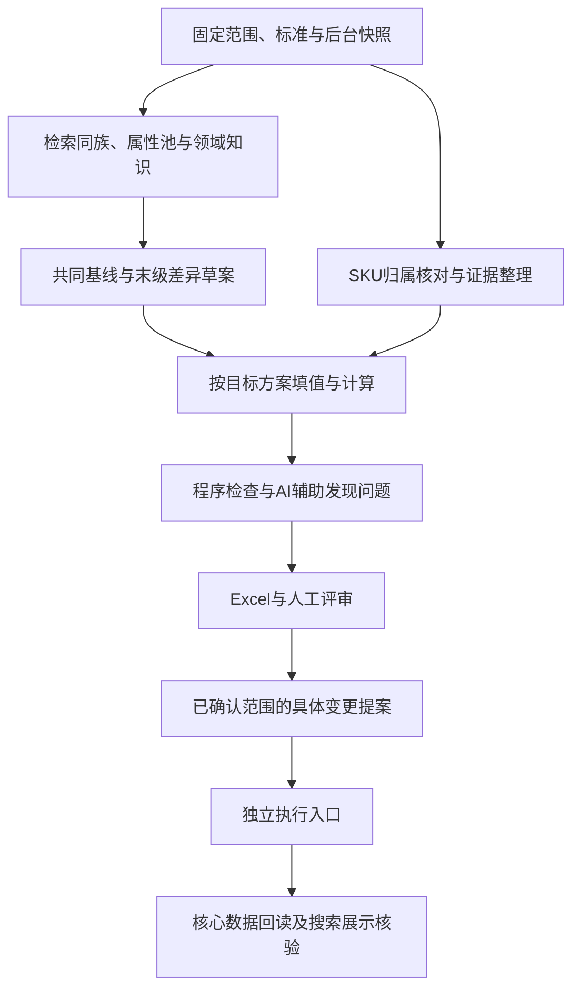

# 商品治理新规范：整体设计与落地合同

日期：2026-10-22。状态：**Q1—Q46及Q47整体理解已确认，作为后续设计基线；执行接线尚未完成。**

本文将已定原则落到阶段、对象、字段、方法和验收，不是新一批商品属性答案。业务规则以[规范草案](governance-standard-draft.md)为准，事实与问答见[设计记录](governance-design-session-20261021.md)，术语见[词汇表](../GLOSSARY.md)。本稿中的命令、工具及试排参数属于设计，不能当作现有可用功能。

| 项目 | 本轮实际状态 |
| --- | --- |
| 问题与根因 | 已查原Excel、v2执行链及本地供应链源码，并记录来源；不只采纳截图表面现象 |
| 业务决定 | Q1—Q46逐项确认，现阶段人工主审，AI生成候选并辅助审核 |
| 后台能力 | 本地源码已查；生产部署、开关和接口效果未全面验证 |
| 小屏 | 已在用户13寸MacBook Air、WPS100%局部操作旧表，旧布局不满足首屏要求；新布局和Windows150%未实测 |
| 实现与运行 | 未建立v3执行入口，未新跑模型、改原Excel或写生产；未证明AI审核准确率 |

## 1. 最终要完成的业务任务

1. 类目建模者能说明：某参数为什么需要、描述什么、怎样填写、同族哪些共用、哪些差异有理由，并能映射到供应链已有配置。
2. 商品治理人员能逐SKU判断：归属是否正确、每个值依据何在、缺失或冲突怎样处理，且基础字段不被重复治理。
3. 审核者在小屏上能读清关键内容、对照差异、查看全文并留下意见；排序、重导出及修订后意见不串行、不错误沿用。
4. 执行人员拿到具体变更提案，清楚哪个对象、哪些字段、原值及目标、影响范围和前提；执行后知道什么已核验、什么仍待同步或处理。
5. 采购使用者能按统一含义比较规格并检索商品，不需要猜单位、把销售总量当单包量，或替系统解决矛盾参数。

“属性更多”“字段填得满”“模型互相通过”“脚本正常结束”均不单独证明这些任务完成。

## 2. 根因与预防机制

| 根因 | 预防动作 | 落点 |
| --- | --- | --- |
| 旧契约本身要求品牌、条件必填等不合理结果 | 先核对基础字段职责，统一新契约，再改真实生成与校验入口 | S0、S2；R01、R02 |
| 各末级独立平铺生成，缺少共同上下文 | 先检索同族与属性池，固定共同基线，再审局部差异 | S1、S2；R03—R05 |
| 参数粒度、单位和口径缺少业务判断 | 每项说明选型用途；按完整参数建模；计算校验因子及适用范围 | S2、S4；R06—R08、R14 |
| 来源记录、程序复算被当成事实正确 | 分开核对来源存在、商品范围、语义支持和计算成立条件 | S3—S5；R09—R15 |
| 专业背景和审核经验未形成可复用方法 | 领域知识包、专业检查清单、真实错误模式与人工样板进入版本 | S1、S5、S6；R17—R20 |
| 导出成功代替真实审核体验 | 两类主任务、小屏试排、全文往返、意见回收实际操作验收 | S6；R21、R22 |
| 规范没有进入所有实际入口 | 每条规则登记执行阶段和验证方法，运行固定全部有效材料及代码版本 | S0—S9；R23 |
| 后台提交成功代替完整业务生效 | 原值/版本保护、逐项回读、异步效果和回退边界分别管理 | S7—S9；R25、R26 |

错误处理形成：问题实例 → 核实范围与根因 → 更新权威规则/知识/方法 → 检查受影响引用 → 验证实际入口 → 人工验收。只改暴露的一个输出，不算预防机制完成。

## 3. 实现落点与复用边界

依用户授权，选择后续在`src/scenarios/product_governance_v3`承载新业务合同，理由及边界见[ADR-0005](adr/0005-v3-contract-with-selected-v2-reuse.md)。当前文档暂留原docs便于追溯；整体确认后再建立新执行边界和规范入口，避免维护两份权威业务规则。

| v2模块 | 保留价值 | 新合同必须补齐的部分 |
| --- | --- | --- |
| `runtime/store.ts`、`providers/deepseek.ts` | 原子保存、请求缓存、预算、有限重试、未知回执 | 全流程成本归集；图像输入及证据；共享同族协调不能只用运行目录锁 |
| `workflows/batch-runner.ts` | 选择范围、标准/样本冻结、阶段恢复、可调并发 | 程序/知识/同族/后台快照版本、实时状态与未知结果处置 |
| `domain/registry.ts`、`tools/catalog.ts` | 显式共享冲突检查、按ID读取 | 生成前搜索、跨父节点同族、基线发布与引用、在途发现和原子占用 |
| `domain/meta.ts`等业务契约 | 定义、绑定、规则、来源分离 | 移除条件必填和基础字段重复治理；完整参数及后台配置映射。**统一SKU已被用户确认，应保留** |
| `trial/` | 引文定位、缺失/冲突状态、算术重算 | 因子来源/口径、参数级外部准入、图片定位和真实单位关系 |
| 意见及审核记录 | 业务ID定位、审核hash、历史版本保护 | Excel跨版本回收、结构化修订、内容变化失效及冲突处置 |
| `reports/review-layout.mjs` | 共同导出、筛选、分组、审核输入及证据保留 | 以新视图重排、全文入口与真实小屏验收 |
| 生产执行 | 现有本地差异和旧值记录可作参考 | 没有已完成的治理生产apply/readback；须建立S7—S9合同 |

不整目录复制，也不为新目录强制全量重跑历史卡。历史产物通过显式版本适配读取，不能混成新标准下已验收结果。

## 4. 阶段、输入、输出与停止范围



| 阶段 | 必需输入 | 产物与核对点 | 不满足前提时 |
| --- | --- | --- | --- |
| S0 范围与版本 | 真实类目ID、商品范围、已发布规范、预算配置、后台能力与快照 | 运行清单、ID映射、基础字段职责表、读取结果及版本 | 核心读取失败记失败，不能当不存在；阻断对应任务 |
| S1 同族与知识 | 固定树、商品对象及用途、既有/在途基线、知识来源 | 同族候选及理由、共同上下文、采用版本、专业疑点 | 语义未确认保留候选；共享前置未就绪阻断依赖 |
| S2 属性建模 | 基础字段排除表、领域知识、共同基线 | 一份共同定义、末级绑定、差异及理由、原生配置投影 | 同批候选可固定后供待审草案使用；不变成跨批默认标准 |
| S3 商品归属与证据 | 原始SKU资料、当前标准归属与实际挂载、现有末级候选 | 当前→目标归属提案；逐参数证据及适用范围 | 归属不明不强挂；已确定事实保留 |
| S4 商品填值 | 固定目标类目草案、属性定义、SKU/销售组合证据 | 类型化候选值、未知/不适用/冲突、直接或派生链 | 未知留空；前提不明不猜数、不复用整页 |
| S5 检查与辅助审核 | S2—S4产物、规则版本、证据 | 程序错误、错误模式、模型异议、待裁定和人工核对范围 | 不能用模型通过或平均分抵消严重问题 |
| S6 人工评审 | 两类审阅视图、同族对照、全文及原始依据 | 结构化意见、审定内容、待复核及隔离范围 | 定点修订后仅核对变更与依赖；不无限整卡重跑 |
| S7 变更提案 | 已确认内容与最新后台状态 | 对象/字段/原值/目标、前提、依赖、版本影响及保护项 | 与审核内容不一致则复核，不静默扩大范围 |
| S8 独立执行 | 已确认提案、服务端前提保护、执行记录 | 真实原生ID映射、逐项回执、已知失败/未知/冲突 | 冲突项及依赖暂停，独立项按条件继续 |
| S9 核验与后续生效 | 提案、回执、实际当前对象及同步状态 | 核心回读、搜索展示效果、剩余问题及可采用范围 | 不以重发核心写入代替查同步；回退另出具体方案 |

S2和S3可在各自前提满足后并行，S4引用固定的目标方案；尚未业务确认的建模和填值均标待审。普通恢复复用未变阶段，业务返修生成新修订并沿依赖失效。改变定义或知识，只重做实际受影响部分。

## 5. 对象、ID与供应链字段合同

### 5.1 三类标识不能混用

治理层的`familyId/attributeId/reviewObjectKey/operationId`用于关系和追溯，不自动等于供应链ID。新建对象通过执行返回值建立真实ID映射，不能把`cat.layer_count`之类逻辑键直接当原生UUID。

本地供应链源码位于`/Users/sanheng/Project/sanheng/uece-base`，以下为模型与列名事实，不是对生产数据库的直接写入指令。

| 对象 | 真实承接与关键区别 |
| --- | --- |
| 标准类目 | `StdCategory.id`；`rawCategoryId`关联稳定目录。商品的标准归属是`Product.stdCategoryId` |
| 目录 | `Category.id`为稳定ID；`CategoryInstance.id`为目录版本，`categoryId`关联稳定ID，`isHead`标当前头，`fatherId`指父目录实例 |
| 属性 | `Property.id`为稳定ID；`PropertyInstance.id`为定义实例，`propertyId`关联稳定ID；没有属性实例`isHead`，有效定义由目录绑定决定；`key`只是映射字段名 |
| 目录绑定 | `PropertyInstanceOnCategoryInstance`以`propertyInstanceId + categoryInstanceId`关联，另查含祖先继承的有效集合 |
| 商品 | `Product.id`为业务商品/SKU ID；`ProductInstance.id`为档案实例，`productId`关联稳定ID，`isHead`标当前头；`spuProductId`指主商品业务ID |
| 实际挂载 | `ProductInstance.categoryInstanceId`及对应路径，不能只改`Product.stdCategoryId`就宣称已重挂 |
| 属性值 | `PropertyValueInstance.propertyInstanceId`引用定义实例；通过`PropertyValueInstanceOnProductInstance(propertyValueInstanceId, productInstanceId)`关联商品实例，值及关联没有当前头标记 |

源码定位：[供应链schema](/Users/sanheng/Project/sanheng/uece-base/prisma/schema.prisma:314)，相关位置为314、405、515、617、671、828、858、8034行；细节与回读口径见设计记录2.5、2.12。生产实施前重新核对部署版本。

### 5.2 属性定义的投影

| 治理含义 | 原生字段/表示 | 核对要求 |
| --- | --- | --- |
| 名称、定义与映射 | `title/description/key/sourceKey` | 名称不替代定义；key/sourceKey与上游、既有模板冲突需核对 |
| 类型 | `valueType: PropertyType` | 使用真实枚举`STRING/NUMBER/BOOLEAN/DATE/OPTION`等；不把`type`误作原生列名 |
| 必填性 | `required: Boolean` | 只有必填/选填；不得残留conditional或自然语言必填条件 |
| SKU填写 | `asSpec=true` | 治理属性统一SKU；基础字段既有职责及旧SPU数据不被擅自迁移 |
| 销售规格 | `isKeySpec` | 仅用于买家实际选择规格的维度，不随asSpec全开 |
| 公开与展示 | `isPublic/displayInTitle/displayInList/sortIndex` | 公开与标题/预览位置独立；按实际销售页面再验 |
| 搜索 | `isSearchable`及相应索引路径 | 当前关键词索引支持STRING+OPTION；数值范围筛选能力另验，不能改文本凑索引 |
| 数值 | `metaNumberUnit`、`metaNumberIsInt`、`metaNumberPrecision`、`metaNumberMinValue`、`metaNumberMaxValue` | 单位、精度和范围属于定义；值仍为数字，口径保持明确 |
| 文本 | `metaStringRegex`、`metaStringMinLength`、`metaStringMaxLength`、`metaStringDisplayMethod`、`needToTrim` | regex是预设格式枚举，不能假装支持任意正则；额外格式校验明确由治理侧执行 |
| 选项 | `metaOptionItems`、`metaOptionIsMulti`、`metaOptionMinCount`、`metaOptionMaxCount` | 原生选项换行列出，项数约束仅多选时有效；治理层数组投影按原生协议校验，不确定多个值不作多选 |
| 默认值 | 各类型`meta*Default` | 默认不设业务预填；入口自动补false/0/首选项须另解决，不能视作商品事实 |

源码：[属性与值类型配置](/Users/sanheng/Project/sanheng/uece-base/prisma/schema.prisma:389)（431、466—503行）。单位变更并不在现有全部版本触发清单内，必须比较有效定义内容，不能仅信实例ID没变就含义没变。旧目录属性用于了解承载和冲突，不自动成为新业务标准；遇到同名、同key或旧SPU字段，须在已审范围内明确复用、替代或迁移方案，不能绕过冲突另建重复字段。

### 5.3 SKU值与变更记录

`PropertyValueInstance.valueType`与实值列配套：STRING→`stringValue`，NUMBER→`numberValue`，BOOLEAN→`booleanValue`，DATE→`dateValue`，OPTION→`optionValue`；多选按原生换行协议。不得把规范、引用、未知状态或审核意见混进普通值字段。来源与状态保存在治理记录中。

以下为**构造的承接说明**，使用用户“5张/包”例子，不是给某个真实SKU新增答案，也不是现成接口payload：

```text
已审参数：每包数量；固定单位：张/包
属性配置：valueType=NUMBER，metaNumberUnit=张/包，asSpec=true
SKU实值：numberValue=5
审核展示：5张/包
证据/推导/确认状态：治理记录关联到该SKU、定义版本和内容版本
```

每项治理变更至少包含：操作ID、业务对象及当前实例、目标定义/目录、字段级before/after、证据引用、规则版本、审核内容hash、前提、依赖、预期影响和保护项。已有品牌、销售单位等基础字段列为保护项，不能随整档保存被意外覆盖。

新增属性先记录拟新增定义和治理ID，S8返回真实属性/目录ID后写入映射；只能解析已审引用，不能借解析ID改变业务含义。配置与绑定核验后，再进入必要的商品目录升级/重挂和值写入。原生服务可能新建档案及值关联，不以直接覆盖某一旧值行替代业务事务。

### 5.4 必须明示的后台缺口

| 缺口 | 承接要求与影响 |
| --- | --- |
| 不同入口对未知补值不同 | 新建/切类初始化可补Boolean默认值或false，复制到标准库补缺属性可补0/false/首选项；普通pushV2缺属性补全使用可空初始化。须按真实入口无损承接未知，省略字段不是通用解法，也不能笼统说pushV2必补false |
| 写入缺少审核快照的原子前提保护 | 服务端在受保护过程中比较原值及相关定义/实例版本；客户端先查当前头不等于原子保护 |
| 配置可能原地改、旧商品目录另升级 | 记录有效定义hash和目录实例；列清后代与商品影响，不把当前目录头误当商品实际挂载 |
| 索引及展示为不同路径、部分更新刷新不一致 | 核心回读与后续效果分开；OPTION开关刷新及数值检索分别验证 |
| 提交后还有同步/识别/历史任务 | 追踪后续效果，防止自动重识别等使标准归属偏离目标；不以HTTP返回盖章完成 |
| 缺少已查范围内的治理幂等回执与整批回退 | 未知结果先查证；逐操作记账，回退检查后续修改和引用，不承诺整批一键恢复 |

这些缺口是实施前提，不用提示词或离线Excel掩盖；不要求为完成离线规范而立即改线上。

## 6. 工具、skill与脚本职责

### 6.1 工具合同（均为待实现设计）

| 工具 | 输入/输出要点 | 不应越界的地方 |
| --- | --- | --- |
| `find_related_categories` | 当前类目/对象、固定树版本→相关候选、路径、匹配维度与检索覆盖 | 相似度和同父节点只作候选，不能自动判同族 |
| `get_family_context` | 目标/同族ID、运行范围→成员、基线/知识版本、引用及在途状态 | 区分已确认、同批待审、其他批待审、生成中、确无结果与读取失败 |
| `search_attribute_pool` | 参数含义/对象/口径→可复用定义、同义词、来源及适用边界 | 同名不自动同义，不把不同重量口径合并 |
| `propose_baseline_change` | 原版本、拟变更、理由→差异、影响引用和候选新版本 | 不静默改已冻结基线，不直接发布到其他批次 |
| 证据读取/外部补证 | SKU及具体参数范围→快照、原文、定位、身份与适用范围 | 某参数可用不代表整页可用；模型工具名不等于真正执行过 |

脚本强制执行前置检索并保存读取版本；agent按skill判断业务关系。工具可以由脚本直接调用并注入上下文，不能因为provider列了工具名就声称已有工具循环。详细检索与并发讨论沿用[工具提案](family-context-tools-and-concurrency-proposal.md)。

固定上下文、阶段skill、动态检索与模型工具循环如何组合，以及目前实际接通到哪里，另见[DeepSeek接入现状与分层方案](deepseek-context-skill-tool-wiring.md)。它是本稿的实现细化，尚未变成可运行代码。

同族身份先经检索与判断，再由共享注册表协调原子占用与发布；锁不能只存在各自运行目录。重叠候选或身份不明时列冲突，不宣称文件锁能解决语义误分组。未具备共同协调能力的独立副本不能对共享池同时发布。锁失效恢复需核对持有者/回执，不盲目删锁重跑。

### 6.2 方法沉淀为skill，专业内容沉淀为知识包

| 方法包（拟建） | 必需内容与真实使用位置 |
| --- | --- |
| 同族与属性建模 | S1/S2；系统字段排除、同族判断、共同基线/差异、用途、类型/枚举/数量完整表达；带有芯/无芯等正反例 |
| 领域知识查证 | S1；对象边界、专业检查清单、实际资料适用性、未核实项及集中裁定问题；可引用多个专业知识包 |
| SKU归属与取值 | S3/S4；对象/销售组合、证据范围、未知/冲突、同品参数复用、计算因子、图片补充及来源保留 |
| 审核辅助 | S5；按错误模式提出有定位的疑点，区分确定性程序错误与业务判断，聚焦变更及依赖；不输出自我通过率 |
| 交付操作核查清单 | S6/S9；小屏实际任务、全文/意见、核心回读及后续生效；排版和算术由程序执行 |

每个方法包应有目的、前置材料、判断步骤、输出合同、常见失败与反例、停止/转人工条件、版本和验收案例。只增加一段通用提示词不算完成。DeepSeek提出普通属性候选及修订，Codex制定准则并核查异常，人工作当前业务采用判断；各方共用业务规范，Codex私有审核操作上下文不塞进生成器。

知识包至少记录适用族/对象、术语与单位口径、关键选型维度、实际资料及版本/定位、已知混淆、反例、未核实疑点。模型知识可作提案；没有读取的标准和网站不能声称已核实。资料被纠正或撤销时发布新知识状态，停止新任务默认引用受影响内容，沿依赖复核相关定义和值，保留历史依据，不静默重写旧运行。

## 7. 规则如何进入执行与验收

下表是**待接线的规则登记表**，不表示这些检查已经实现。程序检查“结构和引用成立”之后，仍可能需要人工判断“业务含义正确”。R编号用于追溯，不新增第二套规则。

| 规则 | 已确认来源 | 执行与检查位置 | 必须验证的结果/反例 |
| --- | --- | --- | --- |
| R01 基础字段职责排除 | 初始要求、Q1、Q26 | S0职责表→S2上下文→S5重复检查→S7保护项 | 品牌不生成新治理绑定；不能按是否存于属性表或名称含“单位”一刀切 |
| R02 二元必填性 | 初始要求、Q7、Q9 | S2定义及原生投影；S5硬检枚举、人工核对必填理由 | 无conditional及自然文本触发规则；必填理由指向实际选型任务 |
| R03 同族共同标准 | Q2、Q6 | S1关系→S2共同定义/差异→S6对照 | 有芯/无芯共用“是否无芯”维度及适用的其他参数；不按类目名自动删特征 |
| R04 同族判断有正反例 | Q8、Q10 | S1检索覆盖与人工分组样板 | 跨直接父节点能发现，同父节点不强并；统计误合并和漏发现 |
| R05 候选、发布与变更 | Q11、Q13 | S1/S2固定版本；S6采用；S0校验可用范围 | 同批待审可引用但依赖仍待审，不能跨批默认发布或静默改共享定义 |
| R06 完整数值与单位口径 | Q12 | S2建模及后台投影→S4值→S5检查 | 5张/包是一个业务参数；固定单位不另造单位属性，抽/张无依据不互换 |
| R07 拆分服务独立用途 | Q15 | S2用途说明；S5/S6语义核对 | 尺寸拆分须有独立选型/适配/计算用途，不为细分而细分 |
| R08 类型、枚举与多选 | Q16、Q17、Q18 | S2范围→S4取值→S5类型/选项检查；S6语义确认 | 枚举外保留依据并修订候选；不确定多个值、不同SKU不能混成多选 |
| R09 未知/不适用/否/0 | Q19 | S4状态与原始值→S5→S7映射及回读 | 缺证业务值留空，false/0必须有据；入口默认值不掩盖未知 |
| R10 默认与派生 | Q20 | S2默认配置；S4派生链；S5核前提 | 不以常见值代替事实；已核实归属与规则可推导固定特征 |
| R11 建模与取值依据分开 | Q4 | S1知识和用途；S3/S4逐SKU证据；S5范围核对 | 当前商品没写某参数，不证明参数不必要；引文存在不等于支持该值 |
| R12 证据冲突 | Q21 | S3范围校验→S4冲突→S6裁定 | 先核同SKU/组合/版本/口径，真实冲突保留，不按固定来源排名消失 |
| R13 参数级外部复用 | Q23 | S3同品与参数准入→S4 | 同型号异包装不能整页搬；本体参数复用须有对应适用依据 |
| R14 计算证据链 | Q22 | S4提因子→程序核来源/单位/范围并计算→S5 | 复算同值不等于前提成立；不可猜每提数量、循环自证或泛用convert乘法 |
| R15 图片为补充 | Q24 | S3图像快照/转写/定位→S4范围核验 | 模糊文字、混合规格、外观推测先待确认；与文字冲突不自动覆盖 |
| R16 归属与实际挂载 | Q25 | S3现有末级检索→S7分操作→S9读真实实例 | 标准类目改动不冒称重挂完成；现有类目不明不强行新建或近似归入 |
| R17 专业知识与分流 | Q14、Q44 | S1检查清单/实际资料→S5/S6专业疑点 | 不只等模型自报不懂；不以删字段或设选填解决关键定义不清 |
| R18 人工主审 | Q3、Q36 | S5辅助意见→S6业务判断 | AI仍能提候选；AI一致和本批交付通过不等于可独立审核 |
| R19 能力验证与根因扩查 | Q32、Q33、Q34 | 独立人工保留案例；错误模式及依赖查询 | 调优案例不冒充未见验收；真/构造分统计，漏检沿同根因检查受影响项 |
| R20 报告口径 | Q5、Q35 | S5/S6/S9统计范围与人工判定 | 填充率不当准确率，比例有分子分母，已填正确性不替代全范围覆盖 |
| R21 小屏审核体验 | Q27、Q29、Q30 | S6列序/试排→目标环境真实操作 | 关键判断与审核入口同时可见，全文可达；不能用缩字号或静态图替代实测 |
| R22 意见与内容版本 | Q28 | S6导出/回收/修订 | 按对象键及审定内容关联；排序不串，实质变化标待复核并保留历史 |
| R23 同版规则真正加载 | Q46 | S0清单及程序版本→每阶段核对 | 模型材料、schema、policy、检查代码不能混版；登记真实执行入口及正反例 |
| R24 恢复、成本与轮次 | Q39、Q45 | 调度、回执、缓存、累计账本 | 未知不重发，业务返修另版；到上限保存并报告，不重置费用或降质过关 |
| R25 配置及独立执行 | Q26、Q37、Q38、Q40、Q43 | S2配置→S7提案→S8服务端前提保护 | 全SKU不等于全关键规格/展示/搜索；人工已改则冲突，不覆盖或自动上线 |
| R26 采用、核验与回退 | Q31、Q41、Q42 | S6隔离→S8回执→S9回读/补偿 | 已知严重问题解决或隔离；部分成功分项报，旧版本不等于一键回退 |

例如R01落地至少要改到：基础字段职责表、生成前上下文、产物检查、执行保护项和验收例。仅删除Excel品牌行而保留生成器强制品牌，不能算该规则已接线。

## 8. 人工样板、验收案例与报告

### 8.1 第一组可复核案例规格

下表是待组装的验收规格，未运行新模型、未形成准确率测试。真实反馈/源码案例与构造情境分别标识；旧结果的存在不等于旧业务值都已被人工判定正确。

| 编号 | 来源性质与场景 | 预期观察 |
| --- | --- | --- |
| E01 | 真实反馈：21类仍有品牌 | 排除新治理品牌绑定，基础品牌职责及原值不误删 |
| E02 | 真实反馈：条件必填 | 新契约只允许必填/选填，不能仅隐藏条件列 |
| E03 | 真实反馈：有芯/无芯属性漂移 | 相同含义共用定义，统一区分维度，有依据的局部差异可保留 |
| E04 | 真实定义差异：标称重量/净重 | 先核测量对象及含芯范围，不因名称相近立即合并 |
| E05 | 真实拆分模式＋构造5张/包示例 | 一个数量参数，数值/单位原生承载且组合可读 |
| E06 | 真实争议类型：销售单位与内容计数 | 排除已有交易字段，但不按“单位/销售”字样误删独立参数 |
| E07 | 构造：缺证、明确false、明确0、不适用 | 四类分别保存，不能经导入/回读变成同一空值或默认值 |
| E08 | 构造：枚举外新值与不确定多值 | 同义词归一或提修订；不硬塞旧选项、不伪造多选 |
| E09 | 构造：标题/详情针对不同规格 | 排除已证实无关范围；同范围真冲突保留，不固定“标题优先” |
| E10 | 构造：同型号不同包装 | 本体与包装参数按证据范围分别复用，不能整页搬运 |
| E11 | 构造：10卷/提×4提，与只有4提 | 前者在前提有据时算40卷，后者不反推因子 |
| E12 | 构造：混装、赠品、抽/张转换 | 明确计量对象及实际关系，否则相关计算待确认 |
| E13 | 构造：清晰标签/模糊图/多个规格 | 只采用已核对目标的可辨内容，原图定位可回查 |
| E14 | 构造：错挂但标准归属与实际挂载不一致 | 提案分操作，核验真实目标目录实例及属性有效集合 |
| E15 | 真实机制缺口：意见重导出及内容变化 | 排序不串；纯排版保留，含义/单位/证据变化失效相关结论 |
| E16 | 构造：已完成步骤、已知失败、未知超时 | 复用、有限重试和待处理分别走；恢复费用不归零 |
| E17 | 构造：审核后人工已改值 | 服务端前提不符即挂起冲突，不能覆盖人工新值 |
| E18 | 真实链路机制＋构造结果：写入成功/同步未完 | 核心回读与搜索展示分别记录，不假报全部完成或重写核心 |
| E19 | 构造：部分成功后已被他人引用 | 保留独立正确项；补偿先核引用及后续变化，不整批强还原 |
| E20 | 真实旧表长文本与小屏问题 | 新试排完成全文往返、意见输入/回收和小屏可达任务，不能沿用旧PASS记录 |

首轮以现有清洁纸品问题做规则推演和离线样例，建议覆盖有芯/无芯、坐垫纸和厨房纸巾等已知情境；不由Codex重新产出各类完整属性答案。专业类目另选实际末级、先准备知识和裁定依据，不能将清洁纸品参考冒称五金知识。

少量端到端试点可以全量人工核对其有限范围，先确认标准与交付能用；后续扩量再明确必审项和抽查范围。实际人员、样本及具体运行预算在试点计划中落实，当前不冒称已完成或约定统计置信度。

### 8.2 指标定义与采用条件

| 报告项 | 必须交代的口径 |
| --- | --- |
| 关键维度覆盖 | 已正确建模的关键维度/人工确认的应有关键维度；业务必要性来自用途与专业知识，不能用当前商品资料反推全集 |
| 同族一致性 | 已确认应共用参数的适用绑定中，含义/类型/单位/口径一致的数量及不一致明细；有依据的例外单列 |
| 填充率 | 有业务值的项/约定统计范围内的适用填写项；false和0不能被当空值，缺证/冲突/不适用另列 |
| 已填正确性 | 人工已判定正确的已填项/人工已判定的已填项；未判定和无法核实项数量明确，不偷偷剔除后宣称全量准确 |
| 有据漏填 | 人工确认资料足以填写但仍漏填的项/人工确认应可填写的项；与资料不足分开 |
| AI漏检与误报 | 漏检项/人工确认错误项；误报项/人工确认正确项，均附数量、错误类型、真实/构造及已见/保留范围 |
| 交付可用性 | 实际完成任务/约定任务，并记录设备、应用、缩放、文件及视口；未测环境单列 |
| 执行完成 | 请求回执、核心回读、后续效果分别统计成功/失败/未知/待完成；附隔离及影响范围 |
| 成本与效率 | 全轮请求、缓存、失败/恢复/返修成本估计、用量和耗时；注明估价口径，不冒称供应商账单 |

分母为0或尚未裁定时报告“不适用/未评”及原因，不填100%。真实样本与构造题、抽查与全量、已填正确与全范围覆盖分别报告。

采用范围内的已知严重问题须解决或隔离，必审及约定抽查、程序检查、真实交付操作和业务确认完成后结束本批。AI独立审核能力另用人工裁定的未见保留案例验证；用于调优的题移入研发集并补充保留题。当前没有已验证的AI准确率或减少人工门槛，不为结束本批编一个百分比。

## 9. Excel交付规格

### 9.1 工作表与唯一可编辑位置

| 视图 | 用途与信息安排 |
| --- | --- |
| 阅读说明 | 范围、版本、待审/隔离数量、任务入口及审核方式；不在每张主表占多行大标题 |
| 属性方案 | 一行一个类目属性绑定；共同定义和末级适用性明确；结论及意见在主表编辑 |
| 同族对照 | 从同一数据源派生的只读对照，公共定义只列一次，差异及理由可追到绑定审核项；成员多时用窄表列例外，不无限加横向类目列 |
| 商品审核 | 一行一个明确审核项：归属或某项参数；展示商品及规格、原→拟值、依据/异常摘要、结论和意见，不能一次通过误认全部参数已审 |
| 全文与依据 | 完整定义、枚举、用途、来源/引文/图片定位及前后内容；超长内容拆成有序段落行，枚举逐项分行，不丢原文 |
| 修订录入 | 需要改动时填写结构化拟修订值及必要配置；意见只写理由，不自动解析成执行指令；修订值须经类型/范围及内容版本核对 |
| 技术索引 | 治理/原生ID、实例、hash和关系定位，后置；不占主表左侧冻结区 |

原始候选数据与证据不由意见覆盖；界面明确标出审核/修订输入区，权威原始数据另存，回收端校验源字段和版本，未按修订流程的改写列冲突。全文可显示审核状态，但不另建第二份可编辑审核答案。

不预设“锁源数据列＋允许排序”能同时满足需求：Excel受保护区域含锁定单元格时仍不能排序，见[微软工作表保护说明](https://support.microsoft.com/en-us/excel/protect-a-worksheet)。需排序的主表可不用这种保护，改以清晰输入区及回收校验约束误改；具体方案必须在目标应用完成排序与输入验收，WPS效果另测。

### 9.2 初始试排参数（尚未实机验收）

宽度单位为Excel字符宽，**不是中文字符数或像素**。现`reports/review-layout.mjs:110,113`使用`columnWidth`及pt行高；实际显示宽度须在WPS/Excel核对。

| 属性方案列序 | 初始宽度 | 商品审核列序 | 初始宽度 |
| --- | --- | --- | --- |
| 末级类目 | 10 | 商品及规格摘要 | 16 |
| 属性名 | 13 | 审核项 | 12 |
| 定义摘要 | 18 | 当前→建议 | 18 |
| 类型与必填 | 10 | 依据及异常摘要 | 20 |
| 单位及值域摘要 | 18 | 审核结论 | 9 |
| 审核结论 | 9 | 意见 | 18 |
| 意见 | 18 | 全文/修订入口 | 6 |
| 全文/修订入口 | 6 | — | — |
| 合计（仅试排预算） | 102 | 合计（仅试排预算） | 99 |

- 正文字号先试11pt，表头行高26pt，正文最小行高30pt；摘要按内容换行，主表通常控制两行。必要内容超过摘要时明确省略标记及全文入口，不用无上限行高掩盖问题。人工意见完整保存，按实际输入适配，两行是试排目标，不是截断意见的硬限制。
- 自动适配短列并给长列上限；冻结表头与最左两列，必须核对冻结区实际宽度。意见长文本也可换行/进入详细输入，不能被颜色或窄格遮住。
- 长枚举展示若干项及总数，并明确“查看全部”。全文中完整保留，并让审核者能返回原对象。
- “查看全文/返回审核”按稳定对象定位；可试用对象键查找当前行的超链接公式，但必须验证WPS和Excel排序后重算、筛选隐藏及重导出行为，不能把静态行号链接当已解决。
- 字符宽合计只是试排起点。验收按实际列像素宽、行号/滚动条/冻结分隔和可用视窗判断；不够时收紧短列、调整摘要及详情入口，不靠缩字号或让审核者反复拖列。

### 9.3 意见回收合同与真实任务

属性意见绑定“类目ID＋属性ID＋审核内容版本”；商品意见绑定“SKU ID＋审核项＋审核内容版本”。定义与绑定分别定位，审共同定义一次不能掩盖不同绑定的必填/用途差异。回收要检查对象重复、版本匹配、人工修订和冲突，不能按行号或仅匹配属性名。

纯排版/无含义变化错字保留结论；含义、单位、必填、枚举、相关证据等实质变化，保留历史并将受影响项标待复核。人工通过的修订须绑定修订后的审定内容，不能借原通过结论自动批准另一份新内容。

| 必做任务 | 通过条件 |
| --- | --- |
| 判断必填与数值口径 | 在实际可用首屏同时看到参数、关键填写要求及审核入口，无需反复横移 |
| 对照有芯/无芯 | 共用定义及差异有理由可查，不要求靠记忆在两张长表之间猜 |
| 读完整长说明/枚举/证据 | 明确入口，内容完整可读，返回同一审核对象 |
| 录意见→筛选/排序→保存重开 | 对象、意见及修订值保持，不串到相邻行 |
| 重导出并回收 | 未变项保留，实质变化项提示待复核，冲突与重复键可见 |
| 实际环境记录 | 当前13寸MacBook Air上操作即Mac小屏验收；Windows150%单独验证，不用Mac截图替代 |

当前只证明旧版主表局部操作不满足要求；以上新规格尚未生成新Excel、完成往返任务或通过Windows验收。

## 10. 发布、恢复与数据链

一次运行清单至少固定：范围/类目树、实际后台与商品快照、标准/schema/policy、skill/提示词、知识与参考正文、同族基线及采用范围、工具合同/结果、程序版本、模型/协议/参数、预算配置。逐阶段记录真实加载版本、输入输出及依赖hash，不能仅登记文件名或声称“已读”。

沿用现有约定：鉴权密钥只从环境获取，不写入快照、日志或报告；记录有效配置时剔除密钥。

同一权威定义可以投影成提示词、检查器输入和Excel；每个投影验证来源版本。共享规则改变形成新发布，旧运行恢复仍用原版本；若相应代码或资料不可获得，就报告不可按原合同恢复，不能静默套用当前逻辑。

证据原文、图片、来源及意见保持数据身份，不能因为包含命令或建议就改变本次用户授权、调用工具写后台或对外发消息。外部资料进入上下文时标明来源和适用范围。

建议状态按对象分别记录，避免一个混合“通过”字段：执行阶段（未就绪/运行中/完成/失败/未知）、业务结论（待审/通过/需修改/拒绝/待确认/待复核）、取值状态、核心核验与后续生效。现有通用状态可适配，不将新状态设计冒称原生后台已支持。

普通恢复命中相同输入就复用；已产生blocked结果不能靠重跑自动变为已修复。返修另版，只使受影响节点失效。共同前置失败阻断依赖，独立任务继续；预算达到上限停止新增付费步骤，保留在途及未知回执。同批、恢复及返修共用累计费用记录，技术故障重试与业务修复分别限额，扩大额度/轮次显式记变更。

## 11. 命令界面设计

**以下命令尚未实现、未加入package.json，目前不能作为可用指令执行。** 这是后续统一Bun入口的目标。现有v2 `batch-plan/run/status`只覆盖部分建模，不等于下面的全流程。

```sh
# 一条常用命令：离线产生待审成果，预算由显式参数或已确认项目配置提供
bun run governance --category-id <类目ID> --concurrency 32 --budget-cny <本批预算>

# 计划、状态和恢复
bun run governance --category-id <类目ID> --plan-only
bun run governance status --run-id <运行ID>
bun run governance resume --run-id <运行ID>

# 回收人工意见与编制具体变更提案
bun run governance review-import --run-id <运行ID> --file <审阅文件>
bun run governance change-plan --review-id <审核版本ID>

# 独立执行已确认提案、核验及编制回退方案
bun run governance apply --plan-id <已确认提案ID>
bun run governance verify --execution-id <执行ID>
bun run governance rollback-plan --execution-id <执行ID>
```

日常运行不要求指定某个harness；脚本负责调度依赖、成本、恢复及真实工具调用。计划不调用模型或写生产；常用离线命令不自动apply。32是已有入口及用户示例的并发起点，长卡片/图片等真实负载仍需观察，不宣称最佳吞吐；只并发就绪任务，不用加并发掩盖语义错误。预算、技术重试和业务返修的默认数值在代表任务评估后进入项目配置，不将旧50元变成永久定额。

每次结束给出运行ID、标准版本、阶段状态、产物位置、累计费用估计、未完成/隔离/未知数量和可用的下一步指令。恢复状态需从实际阶段及在途回执重建，不能只显示末次summary冒称实时状态。

## 12. 实施顺序与完成证据

以下是设计基线之后的工作顺序，**不是本轮已执行清单**。本轮停在整体设计共同审阅。

| 阶段 | 交付物 | 完成证据及边界 |
| --- | --- | --- |
| P0 本轮设计 | 规范、根因、字段/流程/规则表、交付规格和目录取舍 | Q1—Q46及Q47整体理解已确认；无新业务运行 |
| P1 契约与方法接线 | v3边界、权威发布清单、职责排除表、工具合同、skill/知识模板、离线样例 | 每条R规则能找到实际入口或人工步骤；用明确正反例验证，不能只新增文件名 |
| P2 离线交付闭环 | 两主视图、全文/修订、意见回收及版本失效、状态/预算恢复 | 无模型样例和已有资料完成排序/重开/重导出；在用户小屏实测，Windows另记 |
| P3 代表性小样 | 经允许的范围与预算、同族/数量/证据/专业场景 | 小范围人工审定并记录真实错误及改进；先证明方法匹配需求，不直接全21类重跑 |
| P4 后台承接与受控演练 | 缺口改造、部署核对、变更提案、受保护执行、回读及补偿 | 前提冲突、未知结果、部分成功、异步生效均演练；不能由本地源码存在接口就省略验证 |
| P5 扩量与维护 | 已确认基线/知识版本、参数化运行、问题与采用范围报告 | 依约定范围验收；AI减少人工覆盖另验，不因批量运行成功扩大信任 |

P1/P2可先检验方法与审核体验，不必先解决全部线上改造；S8执行前必须满足对应承接前提。真正缺少的专业资料、负责裁定人员、平台效果及样本能力，列为具体待办，不向结果里填“已完成”。

## 13. 已确认的设计基线与范围

用户已于2026-10-22在Q47确认本稿准确表达共同理解，作为后续设计基线。它包含按用户授权作出的v3落点、保留底座与新建合同的边界，以及尚待实证的试排和实施顺序。

本次确认不等于立即跑模型、重做原Excel或执行线上变更。后续先按P1/P2细化和验证；新增业务取舍再讨论，已确认规则不反复重问。历史输出、本地旧标准及原Excel继续保留为可追溯输入，不冒称已经符合新规范。
