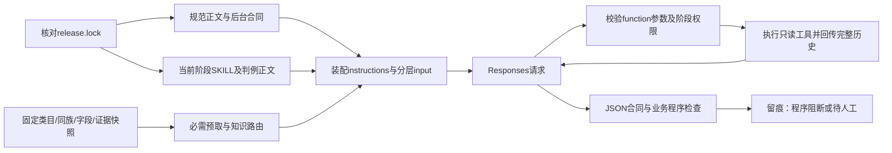

# 商品治理v3：类目属性提案与审阅

v3承载已确认的新合同。当前完成“规则/后台合同 → 阶段skill → 必要知识预取 → DeepSeek Responses工具循环 → 程序检查 → 留痕/恢复”，并提供用户手动触发的类目属性提案批处理。默认预检，`batch --execute`才调用付费DeepSeek；结果待人工采用，没有生产写入。

## 批处理入口

清洁纸品21个末级，先预检，无模型请求：

```sh
bun src/scenarios/product_governance_v3/cli.ts batch --category-id 77e31cf2-8331-4c73-ab10-823d2d1d7ab0 --concurrency 32 --out outputs/product-governance-v3/clean-paper-batch-20261023
```

本地`.env`设置`DEEPSEEK_API_KEY`后，原命令加`--execute`正式生成。根类目ID和并发均为参数，同族共同方案先于末级并发，全批共享费用与恢复记录，完成自动导出属性审阅Excel。只设计属性，不填商品值。[批处理运行手册](docs/batch-runbook.md)列明参数、费用假设、恢复和知识边界。本次开发只有离线模拟验收，未替用户跑真实DeepSeek。

2026-10-22已完成[第1、2步合同/接线修复](docs/implementation-phase12-20261022.md)，并继续完成[第3步小卷纸真实样板](docs/implementation-phase3-20261022.md)：两类各3件真实SKU、字段盘点、专业研究、原文提取和初次人工核实。当时117项v3和18项相关v2回归通过，使用Codex候选离线回放，无真实DeepSeek或人工采用，当时未开放跑批。2026-10-23用户授权新增上述手动批处理；同族正式发布、通用采用和生产承接仍未闭环。[原审计](docs/implementation-audit-20261022.md)保留当时证据。

2026-10-23[纠正审阅对象](docs/review-object-correction-20261023.md)：当前首先审核**类目属性方案**，旧事实工作簿留作后续辅助材料。随后根据人工反馈完成[业务准入与简明命名修订](docs/attribute-admission-refinement-20261023.md)：当前为7项共用选填定义、6项独立扩展候选，替代最初9项+4项试排。名称和定义同步修订；每卷数量的张/节/格口径仍待核实。方案意见尚无自动采用入口，不能使用事实导入器承接。

业务规则由本目录的[已确认规范](docs/governance-standard-draft.md)维护，后台承接引用[整体设计第5节](docs/governance-design-v1-20261022.md)。本轮新规范、整体稿、讨论记录、工具方案、5份ADR及[词汇表](GLOSSARY.md)已迁入v3，统一入口见[文档导航](docs/README.md)。每份正文只维护一处；v2保留其历史架构、运行手册和效率审计。v3不加载v2旧standards、旧品牌强制项或conditional合同。代码复用v2仅限`runtime/store.ts`的原子文件、锁、序列化及hash函数，这个依赖同样被版本锁定。

## 直接运行

在仓库根目录、已安装项目依赖的Bun环境执行：

```sh
# 构造资料 + 模拟HTTP，五个阶段都实际调用工具再回传结果
bun src/scenarios/product_governance_v3/cli.ts offline-acceptance --out outputs/product-governance-v3/offline

# 正反例、越界、证据、预算、恢复和版本检查
bun test ./src/scenarios/product_governance_v3

# v3及直接依赖的类型检查
./node_modules/.bin/tsc -p src/scenarios/product_governance_v3/tsconfig.json --noEmit

# 直接检索本地完整v2树，不连接后台
bun src/scenarios/product_governance_v3/cli.ts tree-search --tree scratch-category-baseline-20261010/mapped-tree.json --query 小卷纸 --limit 10
```

`offline-acceptance`可重复运行；已有持久响应会重放，不必再次发送模拟请求。输出`acceptance.json`及各阶段的`runs/*.manifest.json`、`*.result.json`、`requests/*.request.json`、响应/回执与`budget.json`。结果记录实际读取的材料hash、工具调用、引用范围和程序报错。完整请求含商品资料，按内部业务资料管理；鉴权密钥不写文件。

现有snapshot可先做只读装配预检，不调用模型：

```sh
bun src/scenarios/product_governance_v3/cli.ts plan --snapshot /绝对路径/snapshot.json --category-id 真实末级ID --stage family-modeling --run-id 本批ID --out /绝对路径/plan.json
```

`sku-filling`、`fact-extraction`另需`--product-id`；`review-assistance`另需`--candidate` JSON文件，包含`stage`（family-modeling或sku-filling）和`result`（候选结果）。审核SKU取值时需带对应`--product-id`读取证据。候选程序错误直接进入审核上下文，并继续阻断结果，模型不能靠空意见列表把错误抹掉。参数严格校验，错命令/未知参数报错。`batch`调用相同`runStage`，共享全批预算和冻结依赖，不接受商品试填阶段；没有`apply`入口。

小卷纸的只读采集、准备、录制回放、工作簿与初次事实意见导入，见[样板运行说明](docs/roll-pilot-runbook.md)。只有显式`capture-roll-pilot`联网读取供应链及其密钥；固定两类各最多3件，不自动翻页/重试。模型密钥只由`batch --execute`读取，其余入口维持离线。

## 资料怎样真正进入DeepSeek



| 层 | 实现及边界 |
| --- | --- |
| 固定规则 | `rules.ts`登记R01—R26的来源章节、阶段、程序入口、开发回归证据、人工问题、未实施项及正反例；`release.ts`按登记加载规范及后台合同，包含原先漏接的采用/结束/核验/回退/成本规则 |
| 阶段skill | `skills/`中建模、原文事实提取、SKU取值、审核辅助、领域研究各一包；正文及必需判例直接进入instructions，文件路径索引不算加载 |
| 动态知识 | `knowledgeRequirements`固定当前范围必读项，优先于名称路由；`knowledge_list`发现全部白名单资料，`knowledge_read`补读。缺必读知识在请求前阻断依赖阶段，研究阶段保留具体问题 |
| 同族与属性池 | 固定快照区分confirmed、同批/他批候选、在途、失败；按类目及相关族预取定义，模型可再按概念查询；共用定义保持一致，类目绑定差异有理由且仍待审 |
| 工具循环 | 真实`tools`声明、严格参数验证、调用分发、`call_id`配对及完整历史回传；服务端不替我们管循环上限 |
| 程序检查 | 直接检查最终输出并决定是否阻断；不能靠模型自报“检查通过”；程序通过仍待人工 |

必要的节点/祖先、跨分支候选、同族基线、字段职责、属性池命中、适用知识及SKU资料由程序预取，不依赖模型主动想起去查。分页和切片明确total、truncated、nextCursor/nextOffset；必需预取超过上下文预算就阻断，不静默删资料。

共11个工具：`categories_search`、`categories_get`、`categories_children`、`find_related_categories`、`get_family_context`、`search_attribute_pool`、`knowledge_list`、`knowledge_read`、`sources_read`、`calculation_policies`及`calculate_value`。策略发现限SKU填写/辅助审核，计算只限SKU填写；策略ID、版本及因子约束实际前置并进入工具回传。没有任意文件、URL、SQL或写入工具。同族搜索结合已登记成员和跨父节点词形候选，**尚未实现语义归族自动判定或共享基线原子发布协调器**；名称相似只产生线索。

DeepSeek适配使用[官方Responses合同](https://api-docs.deepseek.com/zh-cn/api/create-response/)：`instructions`、结构化输出、function调用及结果；无状态多轮需回传完整历史。`ResponsesClient`的离线模式必须注入mock HTTP，fixture禁止使用network模式。联网适配须显式授权、密钥及共享费用预留；CLI只有`batch --execute`进入该路径，本次开发未真实调用。供应链只读另有上述固定小样本入口。

## 数据与版本合同

`Snapshot`定义见[core.ts](core.ts)，严格装载及引用检查见[snapshot.ts](snapshot.ts)，可运行构造样例见[fixtures.ts](fixtures.ts)。`attributes`是可检索池，**不自动成为某类目SKU的填写合同**；取值必须有适用的固定同族合同。新族先建模和确认范围，再制作下一份快照。

快照现在强制`format=2`，旧平铺合同明确拒绝，不静默迁移。共同`attributes`保存名称/概念/类型/单位/口径、数值/文本/选项约束及建模references；`families[].bindings`保存族模板（categoryId=null）及末级覆盖。建模输出将定义存于`attributes`数组，当前末级配置存于`bindings`数组；必填、用途及关键规格/公开/搜索/标题/列表/排序属于绑定。有理由的绑定差异允许待审，共同定义改变仍需另提共享修订。

建模输出另有必带的`extensionCandidates`数组，包含`id/name/conceptKey/scope/potentialUse/deferReason/activationCriteria/references`，无原生类型或绑定。冻结族通过`get_family_context`和必需预取提供该数组，属性池及SKU合同只消费`attributes`。程序拒绝重复、同时进入两种状态、在叶类直接启用冻结扩展候选及候选引用错误。新族可没有准入属性，但必须说明暂缓原因；有既有基线时不能借此省略共同定义。此前format=2快照可省略族的扩展数组，按无扩展读取，不静默制造候选；旧输出须按同版schema重做，不冒充恢复成功。

`systemFieldCoverage`提供来源、版本、声明范围与职责表内容hash，至少保有品牌/供应商/销售单位/规格名称职责。本次盘点4个本地模型233个字段及样本74个原生属性实例，生产部署同版/全局映射和业务完整性仍待核实。`factPreparation`区分fixture/human/agent及candidate/reviewed；agent不能自标reviewed。原生`origin`保留实际标识、JSON定位、原文内容hash；提取候选另带精确引文范围。初次人工导入必须核对稳定候选、来源、合同、release及四项语义确认，仍仅写新的本地快照。`fixture`事实和知识不能混入`local`，程序定位/token检查不证明引文语义。

建模`references`区分knowledge与sku-source，带工具实际返回版本及已读quote；SKU值继续使用evidence中的sourceId/factId。类型配置进入检查及留存的`nativeProjections`：真实原生字段名、SKU开关、数值精度/范围、文本预设/长度、多选计数和展示开关均有离线投影，默认值均为null。投影尚无原生ID与有效实例映射，不能直接发送后台；原生绑定设置实际位于PropertyInstance，同定义不同末级配置还要确定实例/版本承接。

数量计算只接受带`policyId/policyVersion`及`sourceId+factId`的链：实际读取策略和事实，同SKU/组合/口径、单位、均一/赠品依据及因子约束均满足才算；同范围冲突不能只挑支持材料，负数/分数计数因子不能用正结果掩盖。计数量与有符号测量量分开。支持登记乘除和mm/cm/m、g/kg换算；抽/张不自动换算。相邻已读片段会合并，跨边界事实在完整覆盖后连同完整quote回传；未读间隙不会被当成已读。

知识登记包含两个构造路由样例、小卷纸专业研究包、供应链职责清单及清洁纸品准入/研究边界包。真实资料不加载fixture；按对象选择适用包。均待专业/业务人审，未取得完整标准全文，不是已发布行业标准。知识在`KNOWLEDGE`及snapshot白名单/必读范围登记并实际装配；能发现/引用不等于适用性已确认。

每次运行固定`release.lock.json`中的规范、后台合同、skill正文/判例、知识和执行代码hash，并记录实际装配、树/资料、工具合同、输入和运行环境。修改后先审阅变更，再显式更新锁：

```sh
bun src/scenarios/product_governance_v3/cli.ts freeze-release
bun test ./src/scenarios/product_governance_v3
```

freeze只是生成内容指纹，不是新的业务批准。不要通过自动freeze绕过漂移错误。

## 阻断、恢复与验收口径

`program_blocked/not_eligible`表示存在程序错误；`program_pass_pending_human/pending_human`只表示executedChecks所列检查通过，humanReviewRules仍待人工。ruleResponsibilities明确partial和deferred，任何输出都不是已采用结果。actualReads保留包括模型后续补读在内的知识/来源/策略版本、范围及工具历史hash。

请求/响应按实际请求、材料和资料版本生成键。相同请求并发只发送一次；恢复重放持久响应并重建工具读取记录。结果未知保留回执与费用预留，阻止自动重发；资料变更后旧响应不能直接沿用。HTTP尝试每请求一次，自动业务返修为0；轮数、工具数、字节和输出token均有限。批处理共享同一目录的`Budget`，恢复不重置；预留不是账单，禁止默认提额。

| 已进入程序检查 | 仍需人工/后续实施 |
| --- | --- |
| R01—R08：基础字段职责、二元必填、SKU、共享定义/版本、数量单位、重复概念、枚举/多值合同及当前搜索能力 | 业务必要性、同族语义、真正独立的参数用途、专业枚举边界 |
| R09、R12、R14：空缺状态、false/0、引文确实被读、SKU/口径/单位/值匹配、矛盾、因子策略及复算 | 引文是否真正支持事实、外部参数准入、专业判断和人工裁定 |
| R23—R25的接线部分：材料指纹、累计预留、断点、循环/工具上限、离线命令边界 | 完整批处理依赖失效、人工意见闭环、生产执行及版本原子保护 |
| 原文提取/有限单位归一化、初次事实意见导入、样板工作簿意见导出与内容漂移检查已接通 | 引文语义人工核实、已有事实修订/跨SKU合并、通用属性方案采用、Windows150%及独立业务验收 |
| R10—R22、R26其余未实施部分进入相关阶段指令，并保留humanReviewRules | 图片解析、重挂/迁移、真实DeepSeek/留出集评估、生产apply/readback/rollback |

测试中的接线成功率不能转换成真实属性准确率或AI审核能力。验收及剩余缺口见[首两步实施报告](docs/implementation-phase12-20261022.md)和[离线验收说明](docs/offline-acceptance.md)。历史审计脚本固定于旧合同提交，当前回归用`contracts-regression.test.ts`；类型检查仅排除该历史探针，未排除当前测试或运行代码。
