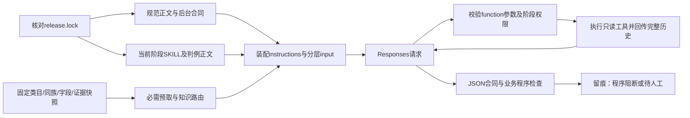

# 商品治理v3：离线接线

v3承载已确认的新合同。当前完成“规则/后台合同 → 阶段skill → 必要知识预取 → DeepSeek Responses工具循环 → 程序检查 → 留痕/恢复”的离线链路。命令不提供付费跑批、自动采用或生产写入。

业务规则继续引用[已确认规范](../product_governance_v2/docs/governance-standard-draft.md)，后台承接引用[整体设计第5节](../product_governance_v2/docs/governance-design-v1-20261022.md)。不复制两套规范，也不加载v2旧standards、旧品牌强制项或conditional合同。复用v2仅限`runtime/store.ts`的原子文件、锁、序列化及hash函数，这个依赖同样被版本锁定。

## 直接运行

在仓库根目录、已安装项目依赖的Bun环境执行：

```sh
# 构造资料 + 模拟HTTP，四个阶段都实际调用工具再回传结果
bun src/scenarios/product_governance_v3/cli.ts offline-acceptance --out outputs/product-governance-v3/offline

# 正反例、越界、证据、预算、恢复和版本检查
bun test ./src/scenarios/product_governance_v3

# v3及直接依赖的类型检查
./node_modules/.bin/tsc -p src/scenarios/product_governance_v3/tsconfig.json --noEmit

# 直接检索本地完整v2树，不连接后台
bun src/scenarios/product_governance_v3/cli.ts tree-search --tree scratch-category-baseline-20261010/mapped-tree.json --query 小卷纸 --limit 10
```

`offline-acceptance`可重复运行；已有持久响应会重放，不必再次发送模拟请求。输出`acceptance.json`及各阶段的`runs/*.manifest.json`、`*.result.json`、`requests/*.request.json`、响应/回执与`budget.json`。结果记录实际读取的材料hash、工具调用、引用范围和程序报错。完整请求含商品资料，按内部业务资料管理；鉴权密钥不写文件。

现有snapshot可先做只读装配预检，不调用模型：

```sh
bun src/scenarios/product_governance_v3/cli.ts plan --snapshot /绝对路径/snapshot.json --category-id 真实末级ID --stage family-modeling --run-id 本批ID --out /绝对路径/plan.json
```

`sku-filling`另需`--product-id`；`review-assistance`另需`--candidate` JSON文件，包含`stage`（family-modeling或sku-filling）和`result`（候选结果）。审核SKU取值时需带对应`--product-id`读取证据。候选程序错误直接进入审核上下文，并继续阻断结果，模型不能靠空意见列表把错误抹掉。参数严格校验，错命令/未知参数报错。当前没有可用的`batch/apply/concurrency=32`入口；后续批处理应调用这里的`runStage`，共享同一批预算和已冻结依赖，不能绕开检查。

## 资料怎样真正进入DeepSeek



| 层 | 实现及边界 |
| --- | --- |
| 固定规则 | `release.ts`按阶段提取规范原文，必带SKU维度、字段职责、证据状态和人审边界；加载后台真实对象、类型、搜索能力及默认值缺口 |
| 阶段skill | `skills/`中建模、SKU取值、审核辅助、领域研究各一包；正文及必需判例直接进入instructions，文件路径索引不算加载 |
| 动态知识 | 从已发布清单及snapshot白名单按类目路径线索选择，正文前置；记录范围/版本，未覆盖明确标gap；按需工具补读 |
| 同族与属性池 | 固定快照中区分confirmed、同批候选、其他批候选、在途、失败；有芯/无芯共享定义，差异写值；同批引用仍待审 |
| 工具循环 | 真实`tools`声明、严格参数验证、调用分发、`call_id`配对及完整历史回传；服务端不替我们管循环上限 |
| 程序检查 | 直接检查最终输出并决定是否阻断；不能靠模型自报“检查通过”；程序通过仍待人工 |

必要的节点/祖先、跨分支候选、同族基线、字段职责、属性池命中、适用知识及SKU资料由程序预取，不依赖模型主动想起去查。分页和切片明确total、truncated、nextCursor/nextOffset；必需预取超过上下文预算就阻断，不静默删资料。

工具包括`categories_search`、`categories_get`、`categories_children`、`find_related_categories`、`get_family_context`、`search_attribute_pool`、`knowledge_read`、`sources_read`及仅取值阶段可用的`calculate_value`。无任意文件、URL、SQL或写入工具。同族搜索结合已登记成员和跨父节点词形候选，**尚未实现语义归族自动判定或共享基线原子发布协调器**；名称相似只产生线索。

DeepSeek适配使用[官方Responses合同](https://api-docs.deepseek.com/zh-cn/api/create-response/)：`instructions`、结构化输出、function调用及结果；无状态多轮需回传完整历史。`ResponsesClient`的离线模式必须注入mock HTTP，构造fixture禁止使用network模式。库中的联网适配需显式授权配置、传入密钥及费用预留上限；本次未调用，CLI没有联网开关，不自动读取环境密钥。

## 数据与版本合同

`Snapshot`定义见[core.ts](core.ts)，严格装载及引用检查见[snapshot.ts](snapshot.ts)，可运行构造样例见[fixtures.ts](fixtures.ts)。`attributes`是可检索池，**不自动成为某类目SKU的填写合同**；取值必须有适用的固定同族合同。新族先建模和确认范围，再制作下一份快照。

快照包含完整树或明确范围树、系统字段职责、同族状态/版本、属性定义、SKU/销售单位、源文与可定位事实、允许的语义计算策略和知识ID。`kind=fixture`仅供测试；`local`也不表示已经业务确认。资料hash按实际内容生成，标签没变而内容变了仍会产生新版本。冻结事实是经过资料准备的输入，不代表程序独立证明了其语义正确；人审继续负责范围、因子含义和专业真实性。

数量计算只接受`sourceId+factId`引用：实际读到原文、同SKU/销售单位、同口径、已冻结目标与因子概念策略、单位抵消、均一/赠品证据均满足后再计算。支持已登记的乘除和mm/cm/m、g/kg换算；抽/张不自动换算。默认值、模型自报因子和调用者布尔断言不能替代证据。

知识包目前只有**两个明确标记的构造路由样例**，不是纸品或五金专业标准。新专业包需要内容来源、适用对象、计量口径、缺口及人工裁定；在`KNOWLEDGE`登记后，由业务snapshot白名单选择。未准备好专业知识时保留待研究，不把跑通接线当作知识完备。

每次运行固定`release.lock.json`中的规范、后台合同、skill正文/判例、知识和执行代码hash，并记录实际装配、树/资料、工具合同、输入和运行环境。修改后先审阅变更，再显式更新锁：

```sh
bun src/scenarios/product_governance_v3/cli.ts freeze-release
bun test ./src/scenarios/product_governance_v3
```

freeze只是生成内容指纹，不是新的业务批准。不要通过自动freeze绕过漂移错误。

## 阻断、恢复与验收口径

`program_blocked/not_eligible`表示存在程序错误；`program_pass_pending_human/pending_human`只表示已列程序检查通过。任何输出都不是已采用结果，没有AI自动批准字段。

请求/响应按实际请求、材料和资料版本生成键。相同请求并发只发送一次；恢复重放持久响应并重建工具读取记录。结果未知保留回执与费用预留，阻止自动重发；材料或资料变更后旧响应不能直接沿用。HTTP尝试每请求一次，自动业务返修为0；轮数、工具数、输入/返回字节和输出token均有限。后续批处理须在同一批目录中共享`Budget`，返修/恢复不重置；预留是保守配置额度，实际账单仍需对账，禁止默认提额。

| 已进入程序检查 | 仍需人工/后续实施 |
| --- | --- |
| R01—R08：基础字段职责、二元必填、SKU、共享定义/版本、数量单位、重复概念、枚举/多值合同及当前搜索能力 | 业务必要性、同族语义、真正独立的参数用途、专业枚举边界 |
| R09、R12、R14：空缺状态、false/0、引文确实被读、SKU/口径/单位/值匹配、矛盾、因子策略及复算 | 引文是否真正支持事实、外部参数准入、专业判断和人工裁定 |
| R23—R25的接线部分：材料指纹、累计预留、断点、循环/工具上限、离线命令边界 | 完整批处理依赖失效、人工意见闭环、生产执行及版本原子保护 |
| R10—R22、R26中未自动实现部分已进入相关阶段指令，并在报告保留humanReviewRules | 图片解析、重挂/迁移、留出集评估、Excel新布局及小屏验收、意见回收、生产apply/readback/rollback |

测试中的接线成功率不能转换成真实属性准确率或AI审核能力。验收记录见[离线验收说明](docs/offline-acceptance.md)。
